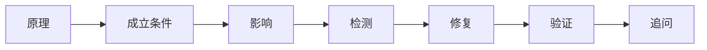

# 使用说明与 PDF 资料口径

这套仓库不是“背答案”的速查表，而是一套面试推理框架。公开面经用于确认哪些问题长期高频；OWASP、NIST、MITRE、CISA 等官方资料用于校准 2026 年回答口径。题目措辞经过归纳和重写。

## PDF 原始定位

- 参考《剑指 Offer》的“题目 - 思路 - 答案 - 追问 - 易错点”编排思想，但不复制其原文、题目或版式。
- 所有“真题”均指公开面经中长期重复出现、并经过重构的高频面试问法；不声称是任何公司的内部题库或逐字原题。
- 攻击相关内容以合法授权、安全面试和防守工程视角为主，重点解释漏洞成立条件、检测证据、修复与验证。

## 建议答题骨架

1. 一句话定义。
2. 解释成立条件 / 信任边界。
3. 说明影响与检测证据。
4. 给出工程修复。
5. 说明如何验证修复。
6. 接住面试官追问。

## 2026 年版本校准

- OWASP Top 10:2025：Broken Access Control 仍是 A01；Software Supply Chain Failures 为 A03；同时强调 Security Misconfiguration、Insecure Design、Logging & Alerting、Exceptional Conditions 等根因类风险。
- OWASP ASVS 5.0.0：2025-05-30 发布。
- NIST CSF 2.0：Govern、Identify、Protect、Detect、Respond、Recover。
- NIST SP 800-61 Rev.3：2025-04 发布，并强调将 Incident Response 融入 CSF 2.0 风险管理。
- CISA KEV：已在野外利用漏洞的权威目录，可用于漏洞优先级。
- MITRE ATT&CK：用于行为映射、检测覆盖和 Purple Team；分类会持续演进，不建议死背 Technique ID。

## 公开面经证据（用于“真题性”校准）

- 多家安全岗位公开面经长期重复出现 SQL 注入、XSS/CSRF、预编译边界、Java 反序列化、TCP/TLS、内网、WebShell 检测、应急响应、编程与项目深挖。
- 部分头部互联网公司公开面经会继续追问预编译边界、同源策略、JNDI/RMI、补丁 diff 等，说明面试正在从概念记忆转向根因和工程实践。
- 安全厂商与甲方岗位通常同时考计算机基础、Web、主机、内网、应急与代码能力；岗位越高级越偏向场景题和设计题。
