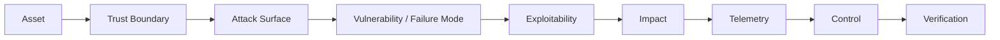

# 把 100 道题变成 1 个统一模型

真正的面试能力不是记住 100 个答案，而是能从陌生场景中推导出正确的安全问题、证据与工程控制。

- **Asset**：保护什么？
- **Trust Boundary**：哪里发生信任等级变化？
- **Attack Surface**：外部可以影响哪些输入、身份或状态？
- **Failure Mode**：什么安全不变量被破坏？
- **Exploitability**：成立还需要哪些权限、可达性和环境条件？
- **Impact**：真实业务影响是什么？
- **Telemetry**：怎么证明发生过、是否还在发生？
- **Control**：根治和纵深防御分别是什么？
- **Verification**：怎么证明修复长期有效？
