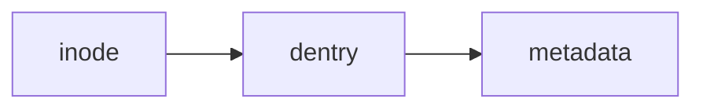

# Q73 inode 是什么？文件名存在哪里？

> **一句话核心结论**：inode 表示文件对象及其 metadata/数据映射，文件名通常存在目录项中，由 name 映射到 inode。

| 维度 | 信息 |
|---|---|
| 高频度 | ★★★★★ |
| 难度 | 基础 |
| 章节 | 文件系统与存储 |
| 关键词 | `inode` · `dentry` · `metadata` |

> [!NOTE]
> 本页“核心结论 / 深度解析 / 面试回答模板 / 常见追问 / 易错点”来自原 PDF 的对应题目；“仓库增强”章节为本仓库在不改变原题主线的前提下增加的机制连接、面试评分、实验与工程视角。

## 1. 为什么面试官喜欢问这题

这道题不是单独考一个名词，而是在检查候选人是否能把 **inode → dentry → metadata** 放进完整的操作系统因果链。优秀回答应同时覆盖：概念边界、底层机制、Why、trade-off，以及至少一个 Linux/工程落点。

## 2. 核心结论（原 PDF）

inode 表示文件对象及其 metadata/数据映射，文件名通常存在目录项中，由 name 映射到 inode。

## 3. 深度解析（原 PDF）

因此同一 inode 可以有多个 hard link 名称。删除文件名只是移除一个目录项并减少 link count；只要仍有其他链接或打开引用，数据未必立即释放。

## 4. 仓库增强：从机制而不是术语理解

- 先分清 namespace、对象身份、打开实例和缓存：filename、inode、open file description、fd、page cache 是不同层级。
- “write 返回”与“durable”不是同义词；崩溃一致性要讨论 writeback、fsync、journal 和设备 flush。
- 优化文件 I/O 时应先确认瓶颈是在 page cache、filesystem、block layer 还是设备，而不是直接套 direct I/O。

### 4.1 知识连接图



### 4.2 面试时应主动说明的边界

- **概念边界**：不要把本题中的核心对象与相邻抽象混为一谈；先明确“谁负责什么”。
- **时间边界**：区分创建/注册/触发/完成/回收等阶段，很多 OS 题的坑来自把不同阶段压成一句话。
- **性能边界**：区分快路径与慢路径、缓存命中与未命中、用户态与内核态、无竞争与有竞争。
- **正确性边界**：说明机制保证了什么、没有保证什么；避免“只要用了 X 就一定线程安全/一定持久/一定异步”之类绝对化表述。

## 5. 面试回答模板（原 PDF）

一句话：“filename belongs to directory entry; inode stores file metadata and block mapping”。

### 5.1 30 秒版本

> inode 表示文件对象及其 metadata/数据映射，文件名通常存在目录项中，由 name 映射到 inode。 进一步来说，回答时我会先界定 `inode` 的职责，再说明它与 `dentry` 的关系，最后补一个性能或 Linux 实现上的 trade-off。

### 5.2 2 分钟版本

1. **定义/边界**：先给上面的核心结论。
2. **机制**：用 3-5 个状态变化解释底层发生什么，而不是只列优缺点。
3. **Why**：说明没有这个机制会出现什么正确性、隔离或性能问题。
4. **Trade-off**：指出它付出的 CPU、内存、调度、I/O 或工程复杂度成本。
5. **Linux/工程**：给出一个可观测入口或真实故障场景。

### 5.3 5 分钟深挖方向

如果面试官继续追问，可把本题扩展到：

1. 为什么 hard link 不能轻易跨文件系统？

## 6. 面试官常见追问（原 PDF）

1. 为什么 hard link 不能轻易跨文件系统？

## 7. 易错点 / Gotcha（原 PDF）

> [!WARNING]
> 说 inode 内保存完整路径名。

## 8. 仓库增强：如何判断自己的回答是否够深

| 层级 | 面试表现 |
|---|---|
| 及格 | 能准确给出 `inode 是什么？文件名存在哪里？` 的核心定义，不混淆相邻概念。 |
| 良好 | 能解释底层机制与关键状态变化，并指出至少一个为什么需要它。 |
| 优秀 | 能讨论正确性/性能 trade-off，并主动回应边界条件与常见误区。 |
| 高阶 | 能落到 Linux/工程实现、可观测指标或故障场景，并将问题连接到相邻知识点。 |

## 9. Linux / 工程实践

**建议实验：观察 pathname、fd、缓存与 I/O**

```bash
strace -f -e trace=openat,read,write,fsync,fdatasync <command>
lsof -p <PID> | head
iostat -xz 1
```

这些命令不是为了“背工具”，而是训练从 OS 抽象回到可观测证据：看到什么现象、对应哪个内核子系统、下一步如何验证。


<!-- BEGIN DEEP-DIVE-V2 -->

### 9.2 机制级推演：把每一步说清楚

面试中建议先给出这一条**总调用链**：

```text
fd/path → VFS → dentry/inode/page cache → filesystem/block → stable storage
```

再展开本题的具体状态变化：

1. 目录内容保存name到inode number的映射。
2. 路径解析拿到dentry。
3. dentry关联inode对象。
4. inode描述权限、大小、时间与数据映射。
5. 多个hard link可让不同名字指向同一inode。

> **关键不变量**：inode通常不保存“唯一文件名”；文件可没有目录名但仍被打开引用。

### 9.3 性能模型：不要只说“快/慢”

pathname lookup受dentry/inode cache显著影响；metadata-heavy workload可能瓶颈不在文件数据。

建议在回答中至少显式区分下面四类成本：

| 成本类型 | 本题应该追问什么 |
|---|---|
| CPU | 是否存在额外指令、扫描、copy、原子重试、内核路径？ |
| Cache / TLB | 是否破坏局部性、触发 cache-line migration、TLB miss/shootdown？ |
| 调度 / 等待 | 是否会 sleep/wakeup、context switch、排队、throttling？ |
| I/O / 持久化 | 是否会触发设备访问、writeback、flush、network round trip？ |

**面试技巧**：如果不能定量到具体纳秒，也不要编数字。更专业的表达是给出“成本由哪些变量决定”，并说明要通过 benchmark/perf/trace 在目标机器上验证。

### 9.4 Linux 实现与源码阅读导航

不要试图背完整源码。先沿对象关系找到“状态放在哪里、谁改变它”。

| 对象 / 接口 | 阅读重点 |
|---|---|
| `dentry` | 路径名缓存/目录项对象；关注name lookup、负dentry及与inode的关系。 |
| `inode` | 文件系统对象元数据与数据映射身份；注意它不同于文件名和打开实例。 |
| `super_block` | 沿调用链确认它保存的状态、引用关系、快/慢路径以及可从用户态观察到的结果。 |
| `directory entries` | 沿调用链确认它保存的状态、引用关系、快/慢路径以及可从用户态观察到的结果。 |

源码阅读建议遵循：

```text
用户态 API / syscall
        ↓
入口函数与参数校验
        ↓
核心内核对象 / 状态机
        ↓
等待队列 / 调度 / MM / VFS / block 等相邻子系统
        ↓
返回值、错误码与可观测指标
```

### 9.5 边界条件、反例与“不要这样回答”

- **本题最重要边界**：inode通常不保存“唯一文件名”；文件可没有目录名但仍被打开引用。
- 不要把“常见实现”说成“POSIX/硬件永远保证”；架构、文件系统、内核版本和配置都可能改变细节。
- 不要把**机制存在**等同于**性能一定更好**。只有 workload、竞争度、数据规模和硬件条件确定后，性能结论才成立。
- 不要跳过错误路径：权限失败、资源耗尽、超时、signal、进程退出、设备错误等经常是高级追问来源。

### 9.6 高级面试追问树

1. 如果把第 2 步拿掉，系统会失去什么正确性或性能保证？
2. 这个机制在“无竞争/命中快路径”和“竞争/缺失慢路径”下分别发生什么？
3. 如何用 Linux 指标或 tracing 证明瓶颈真的来自本题机制，而不是相邻子系统？
4. 如果要求你在生产环境验证自己的答案，你会选哪些 **counter / tracepoint / syscall / /proc / cgroup** 证据？为什么？
5. 如果把环境从单核变成多核、从本地SSD变成网络存储、或从宿主机变成容器，这个结论哪里会变化？

### 9.7 可复现实验：从“知道”升级到“证据”

```bash
ls -li /etc/hosts
stat /etc/hosts
```

实验时建议记录：

```text
kernel version / CPU model / memory / filesystem / cgroup limits
输入规模与并发度
关键指标 before / during / after
是否可重复出现
```

不要只截图一个结果；至少改变一个变量（例如并发度、文件大小、CPU affinity、cache冷热、内存压力）做对照实验。

### 9.8 面试评分 Rubric（增强版）

| 级别 | 对 Q73 的要求 |
|---|---|
| 1 / 基础 | 定义准确，不混淆核心概念。 |
| 2 / 机制 | 能按上面的状态链解释“底层发生什么”。 |
| 3 / 边界 | 能说明不变量、失败路径和至少一个反例。 |
| 4 / 性能 | 能把成本拆到 CPU/cache/TLB/调度/I/O 中的相关项。 |
| 5 / 系统 | 能落到 Linux 对象、指标、实验，并与相邻题建立因果关系。 |

### 9.9 进一步阅读（官方优先）

- [Linux VFS docs](https://docs.kernel.org/filesystems/vfs.html)
- [ext4 documentation](https://docs.kernel.org/filesystems/ext4/)

> 阅读原则：先看接口/语义文档，再看内核源码；博客适合建立直觉，但不要把博客中的版本特定实现当成规范。


### 9.10 90 秒高级回答：把定义、机制、性能和边界连成一段

> **可直接口述的参考结构**：
> 
> inode 表示文件对象及其 metadata/数据映射，文件名通常存在目录项中，由 name 映射到 inode。机制上，我会把它拆成：目录内容保存name到inode number的映射；路径解析拿到dentry；dentry关联inode对象；inode描述权限、大小、时间与数据映射；多个hard link可让不同名字指向同一inode。性能上，pathname lookup受dentry/inode cache显著影响；metadata-heavy workload可能瓶颈不在文件数据。 Linux/工程实现上要关注 `dentry / inode / super_block / directory entries`。最后我会主动补充边界：inode通常不保存“唯一文件名”；文件可没有目录名但仍被打开引用。 这样回答的重点不是堆术语，而是让面试官看到“语义 → 状态变化 → 成本 → 实现 → 边界”的完整因果链。

### 9.11 如何把这道题做成一个小型系统实验

把实验设计成 **hypothesis → variable → observation → falsification** 四步：

1. **Hypothesis**：先写一句可证伪假设，例如“当某个关键资源/路径进入慢路径时，本题描述的成本会显著上升”。
2. **Independent variable**：只改变一个变量，例如并发度、工作集大小、CPU affinity、I/O 深度、cache 冷热、cgroup limit。
3. **Observation**：同时记录业务结果与 OS 证据，至少包含延迟/吞吐中的一个，以及本题对应的 kernel counter/trace。
4. **Falsification**：如果指标没有按预期变化，不要修改结论去迎合结果；检查是否测错层、是否被缓存/批处理掩盖、是否实际没有进入目标慢路径。

**实验报告最少应包含**：

```text
环境：kernel / CPU / memory / filesystem / container limits
负载：输入规模 / 并发 / 持续时间
变量：本轮只改变什么
结果：throughput / avg / P95 / P99（按适用场景选择）
OS证据：perf / proc / PSI / iostat / strace / tracepoint 中相关指标
结论：支持还是推翻原假设
```

<!-- END DEEP-DIVE-V2 -->

## 10. 关联题目

- [Q74 open("/a/b/c") 大致发生什么？](../07-filesystem-storage/q74.md) - `VFS/path-lookup/dentry/inode`
- [Q75 File Descriptor 到底是什么？](../07-filesystem-storage/q75.md) - `fd/file-description/inode`
- [Q72 Buddy Allocator 与 Slab/SLUB 分别解决什么？](../06-memory-virtual-memory/q72.md) - `buddy/slub/kernel-memory`
- [Q76 Hard Link 与 Symbolic Link 的区别？](../07-filesystem-storage/q76.md) - `hard-link/symlink`
- [Q77 Page Cache 是什么？为什么第二次读文件更快？](../07-filesystem-storage/q77.md) - `page-cache/read/writeback`

## 11. 自测清单

在不看答案的情况下，确认自己能回答：

- [ ] 我能在 30 秒内给出核心定义，并明确不是什么。
- [ ] 我能画出至少 3 个节点的机制链。
- [ ] 我能解释一个关键 Why 和一个 trade-off。
- [ ] 我能回答上面的 3 个追问，而不是只背主问题。
- [ ] 我能指出至少一个 Linux 观测点、命令或工程场景。
- [ ] 我能说出本题与相邻问题的区别。

## 12. 参考资料

### 原 PDF 提供/沿用的官方资料

- [Linux Kernel - VFS](https://docs.kernel.org/filesystems/vfs.html)

### 仓库增强阅读建议

- 《Operating Systems: Three Easy Pieces》：用“虚拟化、并发、持久化”三条主线建立整体模型。
- Linux man-pages / kernel docs：用于核对接口语义与当前 Linux 实现，不要把博客当最终规范。
- 实验时优先记录**可复现输入、内核版本、指标与结果**，避免仅凭一次观察得出通用结论。

---

[← Q72 Buddy Allocator 与 Slab/SLUB 分别解决什么？](../06-memory-virtual-memory/q72.md) · [本章目录](README.md) · [Q74 open("/a/b/c") 大致发生什么？ →](../07-filesystem-storage/q74.md)
