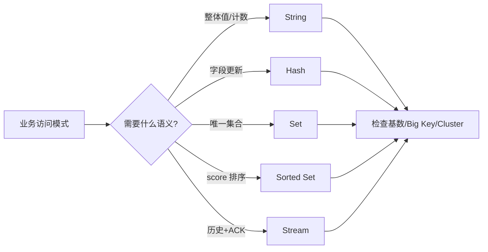

# Q004 · String 最大能做什么？为什么 String 不只是字符串？

> **难度：** 基础必会  
> **所属章节：** 01 · 数据结构与数据建模  
> **PDF 对应页：** 8  
> **目标：** 先在 60 秒内给结论，再用机制、边界和生产验证把答案展开。

## 1. 30–60 秒面试标准回答

Redis String 是 binary-safe value，可保存文本、JSON、Protobuf、压缩字节，也可作为原子计数器、Bitmap 容器、 分布式锁 token、幂等 key。`INCR/DECR/SET NX` 等命令让它成为高并发 primitive。

`INCR page:view:1001`

`SET lock:order:1001 7f2d... NX PX 30000`

## 2. PDF 原理拆解

客户端用 `GET -> +1 -> SET` 会产生 lost update，而单个 `INCR` 在 Redis 核心命令语义下是原子的。 大二进制对象虽能存，但网络、复制、持久化和删除成本会随 value 体量放大。

## 3. PDF 高频追问与答题抓手

- 追问 1 如果数据规模扩大 100 倍，String 最大能做什么？为什么 String 不只是字符串的结论会发生什么变化？

- 追问 2 如何用 OBJECT ENCODING / MEMORY USAGE / --bigkeys 等手段验证你的判断？

答题抓手：对象若总是整体读写，String 最简单；若要字段级读写，再考虑 Hash/JSON。

## 4. PDF 易错点 / Gotchas

不要把 binary-safe 理解成“只支持 UTF-8”；也不要因为能存图片就把大文件塞 Redis。

## 5. PDF 工程落地

对象若总是整体读写，String 最简单；若要字段级读写，再考虑 Hash/JSON。

> **PDF 一句话拿分：** Redis String 是 binary-safe value，可保存文本、JSON、Protobuf、压缩字节，也可作为原子计数器、Bitmap 容器、分布式锁 token、幂等 key。  
> **GitHub 增强版一句话：** String 是二进制安全 value，而不是语言层面的字符串。


## 6. 深度扩展：从“会答”到“能设计”

String 是二进制安全 value，而不是语言层面的字符串。计数器、位图、序列化对象与幂等标记都能建立在 String 上；但把所有对象都塞成巨型 JSON 会牺牲局部更新与网络效率。

### 6.1 成本 / 复杂度模型

GET/SET 常见 O(1)（复制/网络成本与 value 大小相关）；INCR O(1)。

### 6.2 生产判断框架

- 先确定主读写路径，再选数据结构，不要从命令出发反推业务。
- 任何集合型结构都要给出最大基数、增长上限与清理策略。

### 6.3 面试时应主动补出的边界

- 先说明当前结论成立的前提：数据规模、读写比、是否 Cluster、是否允许数据丢失/陈旧。
- 如果涉及集合或批处理，必须说明 Big Key、单次返回体积和核心执行路径阻塞风险。
- 如果涉及 HA/一致性，必须明确网络分区、进程崩溃和 failover 后的行为，而不是只描述正常路径。
- 如果涉及性能，优先给出可观测指标和验证实验，不用“Redis 很快”替代测量。

### 6.4 可观测与验证指标

- `command latency / p99`
- `key count 与 value/member 分布`
- `MEMORY USAGE / encoding`
- `单次 reply bytes`

### 6.5 故障注入 / 实验设计

用真实 value 大小与成员基数压测，而不是只用 16-byte GET/SET；记录 p99、网络带宽和内存/element。

### 6.6 面试白板图



## 7. 进一步追问树

- 如果数据规模扩大 100 倍，访问模式或编码选择会发生什么变化？
- 如何用线上指标或实验验证你的数据结构选择？


## 8. 可操作验证 / 命令示例

> 命令用于验证思路，生产环境执行前应评估数据规模、权限和阻塞风险。

```text
SET counter 0
INCR counter
GET counter
```


## 9. 版本与实现注意

本题以 Redis Open Source 8.10.1（2026-08）为版本基线；经典语义与版本相关实现应分开表述。

> 内部编码、命令集合和新能力会随版本变化。面试中建议先给经典语义，再说明当前版本增量。

## 10. 100 分回答评分尺

| 档位 | 能力表现 |
|---|---|
| 60 分 | 能给出定义和主结论，但没有失效边界。 |
| 80 分 | 能解释关键机制、复杂度，并回答至少两层追问。 |
| 90 分 | 能画出数据流/状态机，说明故障竞态和监控指标。 |
| 100 分 | 能从 SLO、容量、成本与版本约束重新推导方案，并指出什么时候不该使用该方案。 |

## 11. 关联题目

- [Q003 · Redis 有哪些核心数据类型？分别怎么选？](q003.md)
- [Q005 · Hash 和 String JSON 应该怎么选？](q005.md)

## 12. 官方参考

- [Data Types](https://redis.io/docs/latest/develop/data-types/)
- [Object Encoding](https://redis.io/docs/latest/commands/object-encoding/)

## 13. 专业深挖补充（v2）

> **来源说明：** 第 1–5 节保留 PDF 母版主线；本节是 GitHub 增强内容，结合 Redis 官方文档、当前版本实现语义与生产工程实践扩展。

### 13.1 核心机制再推导

String 的价值在于 binary-safe + 一组原子数值/条件写原语。`INCR`、`SET NX PX`、`GETEX` 等让它既是值容器，也是并发控制的基础积木。

不要停留在“记住结论”。面试时建议把本题改写成一条因果链：

```text
业务目标 / SLO
  ↓
Redis 提供的原语或内部机制
  ↓
复杂度、内存、网络与一致性成本
  ↓
故障/扩容时的边界
  ↓
可观测指标与验证实验
```

### 13.2 复杂度、容量与性能模型

不要只看 Big-O：还要把元素基数、value bytes、reply bytes、Cluster slot 和热点分布一起纳入成本。

计算复杂度只说明算法增长趋势，生产还必须补充四个量：

1. **N 到底是什么**：key 数、member 数、字段数、请求数还是字节数；
2. **一次返回多少字节**：很多“查找 O(1)”最终被大 reply 的网络/序列化成本主导；
3. **最坏 key/slot/shard 多大**：平均值无法解释热点和尾延迟；
4. **背景任务是否叠加**：fork、rewrite、expire、eviction、reshard 都可能与前台 workload 竞争资源。

### 13.3 生产案例推演

接口限流可以用计数 String；幂等可以用 request-id String；小对象缓存可以直接存序列化 payload。它们共享同一个注意点：value 大小和过期策略必须受控。

面试中不要只说“可以这样做”，还应给出验收口径：

- 功能正确：正常路径和重试路径结果一致；
- 性能正确：用真实 value/member 分布测 p50/p99/p999；
- 故障正确：节点重启、超时、网络分区或消费者崩溃后状态可解释；
- 运维正确：有容量阈值、报警、回滚和恢复演练。

### 13.4 失败模式 / 什么时候不该这么做

大 blob、频繁局部字段修改、需要服务端查询的复杂文档不适合永远塞成一个 String。

进一步判断时，可以问自己：

- 这个方案是不是把问题从 Redis 转移到了客户端，却没有减少总体复杂度？
- 如果 key、QPS、成员数扩大 10～100 倍，是否出现不可分割的单点成本？
- 如果 primary 在最坏时刻故障，已经返回给用户的结果是否仍然成立？
- 如果 Redis 整层不可用，业务是 fail-open、fail-closed 还是降级到其他数据源？

### 13.5 源码阅读路线

建议从 **命令语义 → 数据结构 → 生命周期/故障路径** 三层阅读，而不是从 `server.c` 顺序翻完整仓库。

- 推荐入口：`src/object.c` + 对应 `src/t_*.c` 命令实现
- 第一步：在该 Redis 版本的 command table 中定位命令 handler；
- 第二步：跟到对象编码/数据结构操作，记录关键 Big-O 和可能的全量遍历；
- 第三步：继续追踪 replication、AOF/RDB、lazyfree、Cluster 等副作用；
- 第四步：对照官方命令页的 `time complexity`、版本变更与 ACL category。

> 源码路径属于阅读导航，不是稳定 API；升级 Redis 后应以目标 tag/commit 为准。

### 13.6 高频追问：标准应答

**追问 A：如果数据规模扩大 100 倍，结论会变吗？**  
要重新估算元素数、value/reply bytes、热点和 Cluster。客户端用 `GET -> +1 -> SET` 会产生 lost update，而单个 `INCR` 在 Redis 核心命令语义下是原子的。大二进制对象虽能存，但网络、复制、持久化和删除成本会随 value 体量放大。

**追问 B：什么时候不该用这个方案？**  
大 blob、频繁局部字段修改、需要服务端查询的复杂文档不适合永远塞成一个 String。 这类边界比背命令更能体现工程判断。

### 13.7 面试官继续深挖时的回答结构

可以按下面顺序组织 2～5 分钟回答：

1. **定义**：一句话说明它解决什么问题；
2. **机制**：画出数据流/状态机，说明 Redis 内部怎样实现；
3. **复杂度**：给 Big-O，同时指出 N 与 byte size；
4. **边界**：Big Key、Hot Key、Cluster、复制、故障时会怎样；
5. **方案**：为什么选它，而不是最相近的替代方案；
6. **验证**：给出线上指标、命令或故障注入；
7. **版本**：若是 Redis 8.x 新能力，明确最低版本和回滚兼容。

### 13.8 本题复习检查表

- [ ] 我能在 30 秒内说出结论，不堆命令名。
- [ ] 我能解释至少一个内部数据结构/状态机。
- [ ] 我能说出 Big-O，并解释规模变量是什么。
- [ ] 我能指出至少两个会失效的边界条件。
- [ ] 我能给出一个真实生产案例或故障时序。
- [ ] 我能给出 3 个以上可观测指标/验证手段。
- [ ] 我能说明 Redis Cluster / replication 对本题是否有额外约束。
- [ ] 我知道目标版本的官方文档入口：<https://redis.io/docs/latest/develop/data-types/>。

---

← [Q003 Redis 有哪些核心数据类型？分别怎么选？](q003.md) | [章节索引](README.md) | [Q005 Hash 和 String JSON 应该怎么选？](q005.md) →
