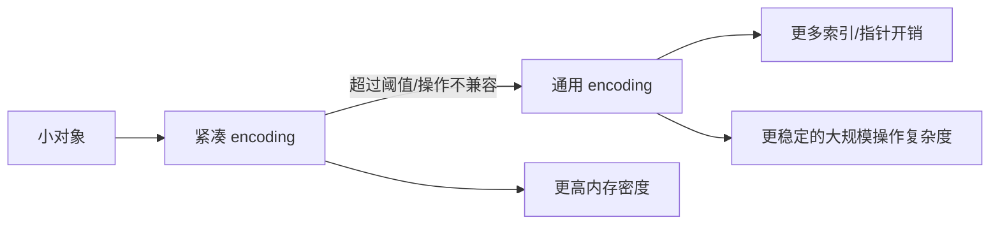

# Q016 · 什么是 Big Key？

> **难度：** 基础必会  
> **所属章节：** 02 · 底层编码与内存机制  
> **PDF 对应页：** 21  
> **目标：** 先在 60 秒内给结论，再用机制、边界和生产验证把答案展开。

## 1. 30–60 秒面试标准回答

Big Key 指 value 体量或成员数量异常大，不是 key 名很长。它会放大命令执行、网络传输、复制、RDB/AOF、Cluster 迁移和内存释放成本。

## 2. PDF 原理拆解

几十 MB String、数百万字段 Hash/Set/ZSet 都可能是 Big Key。 即使某命令计算看似 O(1)，返回整个大 value 的网络成本仍与字节数线性相关； 删除大对象也可能因释放大量内存而阻塞。

## 3. PDF 高频追问与答题抓手

- 追问 1 Big Key 和 Hot Key 有什么本质区别？

- 追问 2 为什么一个 Big Key 在删除、复制和迁移时都危险？

答题抓手：生产应定义单 key 大小/成员数预算，并用 `--bigkeys`、`MEMORY USAGE`、抽样 telemetry 持续监控。

## 4. PDF 易错点 / Gotchas

不要看 key 名长度；不要在线用 `KEYS *` 粗暴排查。

## 5. PDF 工程落地

生产应定义单 key 大小/成员数预算，并用 `--bigkeys`、`MEMORY USAGE`、抽样 telemetry 持续监控。

> **PDF 一句话拿分：** Big Key 指 value 体量或成员数量异常大，不是 key 名很长。  
> **GitHub 增强版一句话：** Big Key 的风险贯穿 CPU、网络、释放、持久化、复制和 Cluster 迁移。


## 6. 深度扩展：从“会答”到“能设计”

Big Key 的风险贯穿 CPU、网络、释放、持久化、复制和 Cluster 迁移。它不是单纯的“大内存”，而是单次操作工作量不可控导致的尾延迟与故障放大器。

### 6.1 成本 / 复杂度模型

成本不是单一 Big-O：序列化、网络、复制、释放和迁移都近似与 value/成员规模成正比。

### 6.2 生产判断框架

- 使用 `OBJECT ENCODING`、`MEMORY USAGE` 和真实数据分布验证内部编码假设。
- 不要把内部 encoding 当稳定 API；版本升级后实现可能变化。

### 6.3 面试时应主动补出的边界

- 先说明当前结论成立的前提：数据规模、读写比、是否 Cluster、是否允许数据丢失/陈旧。
- 如果涉及集合或批处理，必须说明 Big Key、单次返回体积和核心执行路径阻塞风险。
- 如果涉及 HA/一致性，必须明确网络分区、进程崩溃和 failover 后的行为，而不是只描述正常路径。
- 如果涉及性能，优先给出可观测指标和验证实验，不用“Redis 很快”替代测量。

### 6.4 可观测与验证指标

- `used_memory / RSS / fragmentation`
- `encoding 分布`
- `allocator stats`
- `Big Key 与对象基数分布`

### 6.5 故障注入 / 实验设计

构造小对象→大对象的阈值实验，观察 OBJECT ENCODING、MEMORY USAGE 与延迟何时发生跃迁。

### 6.6 面试白板图



## 7. 进一步追问树

- String 20MB 与 Hash 200 万 fields，哪种更危险，为什么？
- Big Key 在 resharding 时为什么会放大故障？
- 这个内部实现在哪个规模阈值附近会发生质变？
- 如何区分“内存省”与“延迟更低”这两个目标？


## 8. 可操作验证 / 命令示例

> 命令用于验证思路，生产环境执行前应评估数据规模、权限和阻塞风险。

```text
redis-cli --bigkeys
MEMORY USAGE target:key
```


## 9. 版本与实现注意

本题以 Redis Open Source 8.10.1（2026-08）为版本基线；经典语义与版本相关实现应分开表述。

> 内部编码、命令集合和新能力会随版本变化。面试中建议先给经典语义，再说明当前版本增量。

## 10. 100 分回答评分尺

| 档位 | 能力表现 |
|---|---|
| 60 分 | 能给出定义和主结论，但没有失效边界。 |
| 80 分 | 能解释关键机制、复杂度，并回答至少两层追问。 |
| 90 分 | 能画出数据流/状态机，说明故障竞态和监控指标。 |
| 100 分 | 能从 SLO、容量、成本与版本约束重新推导方案，并指出什么时候不该使用该方案。 |

## 11. 关联题目

- [Q015 · Redis 为什么会自动改变 encoding？](q015.md)
- [Q017 · Big Key 如何治理？](q017.md)
- [Q020 · Redis 为什么可能出现内存碎片？](q020.md)
- [Q057 · Redis Cluster Resharding 怎么工作？](../06-cluster/q057.md)

## 12. 官方参考

- [Object Encoding](https://redis.io/docs/latest/commands/object-encoding/)
- [Data Types](https://redis.io/docs/latest/develop/data-types/)
- [Cli](https://redis.io/docs/latest/develop/tools/cli/)

## 13. 专业深挖补充（v2）

> **来源说明：** 第 1–5 节保留 PDF 母版主线；本节是 GitHub 增强内容，结合 Redis 官方文档、当前版本实现语义与生产工程实践扩展。

### 13.1 核心机制再推导

Big Key 的危害是“单次不可分割成本”被集中到一个 key：命令处理、序列化回复、复制、持久化、迁移和 free 都可能被它放大。

不要停留在“记住结论”。面试时建议把本题改写成一条因果链：

```text
业务目标 / SLO
  ↓
Redis 提供的原语或内部机制
  ↓
复杂度、内存、网络与一致性成本
  ↓
故障/扩容时的边界
  ↓
可观测指标与验证实验
```

### 13.2 复杂度、容量与性能模型

`Cost_big_key ≈ CPU(element_count) + network(bytes) + replication(bytes) + free/migration cost`。

计算复杂度只说明算法增长趋势，生产还必须补充四个量：

1. **N 到底是什么**：key 数、member 数、字段数、请求数还是字节数；
2. **一次返回多少字节**：很多“查找 O(1)”最终被大 reply 的网络/序列化成本主导；
3. **最坏 key/slot/shard 多大**：平均值无法解释热点和尾延迟；
4. **背景任务是否叠加**：fork、rewrite、expire、eviction、reshard 都可能与前台 workload 竞争资源。

### 13.3 生产案例推演

一个 50MB String GET 本身字典查找是 O(1)，但复制 50MB 到 socket 显然不是 O(1) 的端到端成本；一个数百万成员 Set 的删除也会造成大量释放工作。

面试中不要只说“可以这样做”，还应给出验收口径：

- 功能正确：正常路径和重试路径结果一致；
- 性能正确：用真实 value/member 分布测 p50/p99/p999；
- 故障正确：节点重启、超时、网络分区或消费者崩溃后状态可解释；
- 运维正确：有容量阈值、报警、回滚和恢复演练。

### 13.4 失败模式 / 什么时候不该这么做

不要只给一个统一字节阈值；String、Hash、List、Set、ZSet 的“大”应分别按 bytes 与 member count 定义。

进一步判断时，可以问自己：

- 这个方案是不是把问题从 Redis 转移到了客户端，却没有减少总体复杂度？
- 如果 key、QPS、成员数扩大 10～100 倍，是否出现不可分割的单点成本？
- 如果 primary 在最坏时刻故障，已经返回给用户的结果是否仍然成立？
- 如果 Redis 整层不可用，业务是 fail-open、fail-closed 还是降级到其他数据源？

### 13.5 源码阅读路线

建议从 **命令语义 → 数据结构 → 生命周期/故障路径** 三层阅读，而不是从 `server.c` 顺序翻完整仓库。

- 推荐入口：`src/object.c`, 各 `t_*.c` 删除/遍历路径
- 第一步：在该 Redis 版本的 command table 中定位命令 handler；
- 第二步：跟到对象编码/数据结构操作，记录关键 Big-O 和可能的全量遍历；
- 第三步：继续追踪 replication、AOF/RDB、lazyfree、Cluster 等副作用；
- 第四步：对照官方命令页的 `time complexity`、版本变更与 ACL category。

> 源码路径属于阅读导航，不是稳定 API；升级 Redis 后应以目标 tag/commit 为准。

### 13.6 高频追问：标准应答

**追问 A：如果数据规模扩大 100 倍，结论会变吗？**  
要重新估算元素数、value/reply bytes、热点和 Cluster。几十 MB String、数百万字段 Hash/Set/ZSet 都可能是 Big Key。即使某命令计算看似 O(1)，返回整个大 value 的网络成本仍与字节数线性相关；删除大对象也可能因释放大量内存而阻塞。

**追问 B：什么时候不该用这个方案？**  
不要只给一个统一字节阈值；String、Hash、List、Set、ZSet 的“大”应分别按 bytes 与 member count 定义。 这类边界比背命令更能体现工程判断。

### 13.7 面试官继续深挖时的回答结构

可以按下面顺序组织 2～5 分钟回答：

1. **定义**：一句话说明它解决什么问题；
2. **机制**：画出数据流/状态机，说明 Redis 内部怎样实现；
3. **复杂度**：给 Big-O，同时指出 N 与 byte size；
4. **边界**：Big Key、Hot Key、Cluster、复制、故障时会怎样；
5. **方案**：为什么选它，而不是最相近的替代方案；
6. **验证**：给出线上指标、命令或故障注入；
7. **版本**：若是 Redis 8.x 新能力，明确最低版本和回滚兼容。

### 13.8 本题复习检查表

- [ ] 我能在 30 秒内说出结论，不堆命令名。
- [ ] 我能解释至少一个内部数据结构/状态机。
- [ ] 我能说出 Big-O，并解释规模变量是什么。
- [ ] 我能指出至少两个会失效的边界条件。
- [ ] 我能给出一个真实生产案例或故障时序。
- [ ] 我能给出 3 个以上可观测指标/验证手段。
- [ ] 我能说明 Redis Cluster / replication 对本题是否有额外约束。
- [ ] 我知道目标版本的官方文档入口：<https://redis.io/docs/latest/develop/data-types/>。

---

← [Q015 Redis 为什么会自动改变 encoding？](q015.md) | [章节索引](README.md) | [Q017 Big Key 如何治理？](q017.md) →
