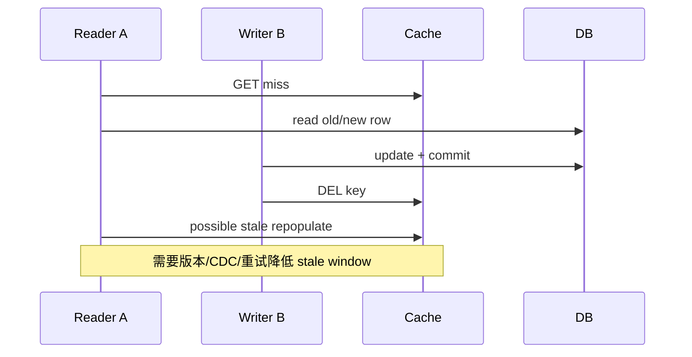

# Q029 · Cache Aside 如何保证数据库和 Redis 一致性？

> **难度：** 高级  
> **所属章节：** 03 · TTL、缓存模式与淘汰  
> **PDF 对应页：** 35  
> **目标：** 先在 60 秒内给结论，再用机制、边界和生产验证把答案展开。

## 1. 30–60 秒面试标准回答

常见写路径是先更新 DB，再删除 cache。它不是强一致协议，而是最终一致策略；相比“更新 DB 同时更新 cache”， 删除更能减少并发旧写覆盖，但 DB commit 后、cache delete 前崩溃仍有脏缓存窗口。

READ:   cache -> miss -> DB -> populate cache

WRITE: update DB -> delete cache

## 2. PDF 原理拆解

读 miss 后回填 cache 也可能与并发更新形成竞态。 增强方案包括删除重试、消息队列、CDC/binlog 驱动失效、版本号/逻辑时间等； 关键是明确允许多长 stale window。

## 3. PDF 高频追问与答题抓手

- 追问 1 为什么通常是“更新 DB，再删除缓存”？

- 追问 2 这个顺序仍有哪些竞态窗口，如何降低？

答题抓手：高分回答最好画两个线程时序，指出至少一个 race window，并说明补偿/CDC。

## 4. PDF 易错点 / Gotchas

不要说“先 DB 后删缓存就完全一致”；不要把 delayed double delete 当万能公式。

## 5. PDF 工程落地

高分回答最好画两个线程时序，指出至少一个 race window，并说明补偿/CDC。

> **PDF 一句话拿分：** 常见写路径是先更新 DB，再删除 cache。  
> **GitHub 增强版一句话：** Cache Aside 只能在给定竞态窗口内实现最终一致。


## 6. 深度扩展：从“会答”到“能设计”

Cache Aside 只能在给定竞态窗口内实现最终一致。高质量回答应画出读回填与并发写的时序，并明确 delete 重试、CDC 或版本号是在降低 stale window，而不是把系统变成强一致。

### 6.1 成本 / 复杂度模型

一致性成本由并发窗口、DB 写延迟、失效消息延迟与重试策略共同决定。

### 6.2 生产判断框架

- 缓存方案必须同时写出 miss、回源、失效、重试和降级路径。
- 关注 hit ratio 之外的数据库 QPS、stale window 与 p99。

### 6.3 面试时应主动补出的边界

- 先说明当前结论成立的前提：数据规模、读写比、是否 Cluster、是否允许数据丢失/陈旧。
- 如果涉及集合或批处理，必须说明 Big Key、单次返回体积和核心执行路径阻塞风险。
- 如果涉及 HA/一致性，必须明确网络分区、进程崩溃和 failover 后的行为，而不是只描述正常路径。
- 如果涉及性能，优先给出可观测指标和验证实验，不用“Redis 很快”替代测量。

### 6.4 可观测与验证指标

- `hit ratio / miss QPS`
- `DB fallback QPS`
- `evicted_keys / expired_keys`
- `stale window 与 rebuild latency`

### 6.5 故障注入 / 实验设计

人为让热点 key 同时失效或让缓存层不可用 30 秒，验证 singleflight、DB 限流和降级是否真的生效。

### 6.6 面试白板图



## 7. 进一步追问树

- 请画出“读 miss 回填”与并发 DB update 的竞态时序。
- CDC 驱动失效仍可能产生哪些延迟窗口？
- 当缓存层不可用时，数据库如何被保护？
- 你允许多长时间的数据陈旧，如何量化？


## 8. 可操作验证 / 命令示例

> 命令用于验证思路，生产环境执行前应评估数据规模、权限和阻塞风险。

```text
# write path
UPDATE database ...
DEL cache:key
```


## 9. 版本与实现注意

本题以 Redis Open Source 8.10.1（2026-08）为版本基线；经典语义与版本相关实现应分开表述。

> 内部编码、命令集合和新能力会随版本变化。面试中建议先给经典语义，再说明当前版本增量。

## 10. 100 分回答评分尺

| 档位 | 能力表现 |
|---|---|
| 60 分 | 能给出定义和主结论，但没有失效边界。 |
| 80 分 | 能解释关键机制、复杂度，并回答至少两层追问。 |
| 90 分 | 能画出数据流/状态机，说明故障竞态和监控指标。 |
| 100 分 | 能从 SLO、容量、成本与版本约束重新推导方案，并指出什么时候不该使用该方案。 |

## 11. 关联题目

- [Q028 · 什么是缓存雪崩？](q028.md)
- [Q030 · Redis Client-Side Caching 是什么？](q030.md)
- [Q027 · 什么是缓存击穿？](q027.md)

## 12. 官方参考

- [Eviction](https://redis.io/docs/latest/develop/reference/eviction/)
- [Client Cache](https://redis.io/docs/latest/develop/clients/client-side-caching/)
- [Data Types](https://redis.io/docs/latest/develop/data-types/)

## 13. 专业深挖补充（v2）

> **来源说明：** 第 1–5 节保留 PDF 母版主线；本节是 GitHub 增强内容，结合 Redis 官方文档、当前版本实现语义与生产工程实践扩展。

### 13.1 核心机制再推导

Cache Aside 的一致性上限来自两个独立事务：DB commit 和 cache 操作无法原子提交。工程上要把竞态窗口变短、可检测、可补偿。

不要停留在“记住结论”。面试时建议把本题改写成一条因果链：

```text
业务目标 / SLO
  ↓
Redis 提供的原语或内部机制
  ↓
复杂度、内存、网络与一致性成本
  ↓
故障/扩容时的边界
  ↓
可观测指标与验证实验
```

### 13.2 复杂度、容量与性能模型

缓存题的真正目标函数通常是 `origin_load = request_rate × miss_rate`，并同时受 stale window 与内存预算约束。

计算复杂度只说明算法增长趋势，生产还必须补充四个量：

1. **N 到底是什么**：key 数、member 数、字段数、请求数还是字节数；
2. **一次返回多少字节**：很多“查找 O(1)”最终被大 reply 的网络/序列化成本主导；
3. **最坏 key/slot/shard 多大**：平均值无法解释热点和尾延迟；
4. **背景任务是否叠加**：fork、rewrite、expire、eviction、reshard 都可能与前台 workload 竞争资源。

### 13.3 生产案例推演

线程 A 读 miss，线程 B 更新 DB 并删 cache，随后 A 把旧 DB 结果回填 cache；解决可用版本号、二次校验、CDC 驱动失效或短 TTL 限制脏窗口。

面试中不要只说“可以这样做”，还应给出验收口径：

- 功能正确：正常路径和重试路径结果一致；
- 性能正确：用真实 value/member 分布测 p50/p99/p999；
- 故障正确：节点重启、超时、网络分区或消费者崩溃后状态可解释；
- 运维正确：有容量阈值、报警、回滚和恢复演练。

### 13.4 失败模式 / 什么时候不该这么做

Delayed double delete 依赖时序假设，不能证明所有网络/GC/事务延迟下都正确；关键业务应使用版本/CDC 等更强机制。

进一步判断时，可以问自己：

- 这个方案是不是把问题从 Redis 转移到了客户端，却没有减少总体复杂度？
- 如果 key、QPS、成员数扩大 10～100 倍，是否出现不可分割的单点成本？
- 如果 primary 在最坏时刻故障，已经返回给用户的结果是否仍然成立？
- 如果 Redis 整层不可用，业务是 fail-open、fail-closed 还是降级到其他数据源？

### 13.5 源码阅读路线

建议从 **命令语义 → 数据结构 → 生命周期/故障路径** 三层阅读，而不是从 `server.c` 顺序翻完整仓库。

- 推荐入口：应用 cache-aside/CDC；Redis 侧 String/TTL
- 第一步：在该 Redis 版本的 command table 中定位命令 handler；
- 第二步：跟到对象编码/数据结构操作，记录关键 Big-O 和可能的全量遍历；
- 第三步：继续追踪 replication、AOF/RDB、lazyfree、Cluster 等副作用；
- 第四步：对照官方命令页的 `time complexity`、版本变更与 ACL category。

> 源码路径属于阅读导航，不是稳定 API；升级 Redis 后应以目标 tag/commit 为准。

### 13.6 高频追问：标准应答

**追问 A：如果数据规模扩大 100 倍，结论会变吗？**  
要重新估算元素数、value/reply bytes、热点和 Cluster。读 miss 后回填 cache 也可能与并发更新形成竞态。增强方案包括删除重试、消息队列、CDC/binlog 驱动失效、版本号/逻辑时间等；关键是明确允许多长 stale window。

**追问 B：什么时候不该用这个方案？**  
Delayed double delete 依赖时序假设，不能证明所有网络/GC/事务延迟下都正确；关键业务应使用版本/CDC 等更强机制。 这类边界比背命令更能体现工程判断。

### 13.7 面试官继续深挖时的回答结构

可以按下面顺序组织 2～5 分钟回答：

1. **定义**：一句话说明它解决什么问题；
2. **机制**：画出数据流/状态机，说明 Redis 内部怎样实现；
3. **复杂度**：给 Big-O，同时指出 N 与 byte size；
4. **边界**：Big Key、Hot Key、Cluster、复制、故障时会怎样；
5. **方案**：为什么选它，而不是最相近的替代方案；
6. **验证**：给出线上指标、命令或故障注入；
7. **版本**：若是 Redis 8.x 新能力，明确最低版本和回滚兼容。

### 13.8 本题复习检查表

- [ ] 我能在 30 秒内说出结论，不堆命令名。
- [ ] 我能解释至少一个内部数据结构/状态机。
- [ ] 我能说出 Big-O，并解释规模变量是什么。
- [ ] 我能指出至少两个会失效的边界条件。
- [ ] 我能给出一个真实生产案例或故障时序。
- [ ] 我能给出 3 个以上可观测指标/验证手段。
- [ ] 我能说明 Redis Cluster / replication 对本题是否有额外约束。
- [ ] 我知道目标版本的官方文档入口：<https://redis.io/docs/latest/develop/data-types/>。

---

← [Q028 什么是缓存雪崩？](q028.md) | [章节索引](README.md) | [Q030 Redis Client-Side Caching 是什么？](q030.md) →
