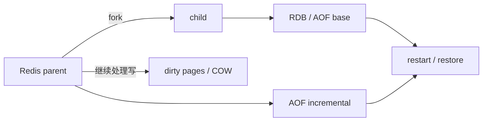

# Q036 · Redis 7 以后的 Multi-Part AOF 是什么？

> **难度：** 中级  
> **所属章节：** 04 · 持久化：RDB、AOF 与恢复  
> **PDF 对应页：** 43  
> **目标：** 先在 60 秒内给结论，再用机制、边界和生产验证把答案展开。

## 1. 30–60 秒面试标准回答

Redis 7 起 AOF 采用 base AOF + incremental AOF + manifest 的 multi-part 结构。rewrite 时生成新的 base，新的写进入增量文件，manifest 决定恢复时哪些文件有效及顺序。

## 2. PDF 原理拆解

它降低旧式 rewrite 的重复写/缓冲压力，让 AOF 生命周期更可管理。 Redis 8.10 的 `BACKUP` 也基于 MP-AOF 体系，说明持久化运维已进入多文件管理时代。

## 3. PDF 高频追问与答题抓手

- 追问 1 这个机制在高并发或故障时最容易失效在哪里？

- 追问 2 如果目标从“性能优先”改成“数据安全优先”，方案需要怎么变？

答题抓手：新版高分点：能说出 base/incr/manifest 三件套及它解决的 rewrite 痛点。

## 4. PDF 易错点 / Gotchas

不要继续按 Redis 6 的单文件 AOF 描述新版本；不要手工随意修改 manifest。

## 5. PDF 工程落地

新版高分点：能说出 base/incr/manifest 三件套及它解决的 rewrite 痛点。

> **PDF 一句话拿分：** Redis 7 起 AOF 采用 base AOF + incremental AOF + manifest 的 multi-part 结构。  
> **GitHub 增强版一句话：** Redis 7 的 MP-AOF 将 base、incremental files 和 manifest 分离，显著减少旧 rewrite 路径的重复写和尾部合并压力。


## 6. 深度扩展：从“会答”到“能设计”

Redis 7 的 MP-AOF 将 base、incremental files 和 manifest 分离，显著减少旧 rewrite 路径的重复写和尾部合并压力。理解 manifest 切换比死记文件名更重要。

### 6.1 成本 / 复杂度模型

持久化成本主要来自数据集字节量、写入速率、fork/COW 和磁盘 fsync。

### 6.2 生产判断框架

- 所有持久化答案都应落到 RPO/RTO 和恢复演练。
- 容量需要预留 fork/COW、rewrite、备份期间的峰值。

### 6.3 面试时应主动补出的边界

- 先说明当前结论成立的前提：数据规模、读写比、是否 Cluster、是否允许数据丢失/陈旧。
- 如果涉及集合或批处理，必须说明 Big Key、单次返回体积和核心执行路径阻塞风险。
- 如果涉及 HA/一致性，必须明确网络分区、进程崩溃和 failover 后的行为，而不是只描述正常路径。
- 如果涉及性能，优先给出可观测指标和验证实验，不用“Redis 很快”替代测量。

### 6.4 可观测与验证指标

- `latest_fork_usec`
- `rdb_bgsave / aof_rewrite 状态`
- `fsync latency / disk util`
- `COW 峰值 RSS 与恢复耗时`

### 6.5 故障注入 / 实验设计

在压测写流量下触发 BGSAVE/AOF rewrite，记录 fork、COW RSS、fsync 和 p99；随后做一次空机恢复计时。

### 6.6 面试白板图



## 7. 进一步追问树

- 这个方案对应的 RPO/RTO 分别是多少？
- 恢复演练如何证明备份真的可用？


## 8. 可操作验证 / 命令示例

> 命令用于验证思路，生产环境执行前应评估数据规模、权限和阻塞风险。

```text
CONFIG GET appenddirname
```


## 9. 版本与实现注意

本题以 Redis Open Source 8.10.1（2026-08）为版本基线；经典语义与版本相关实现应分开表述。

> 内部编码、命令集合和新能力会随版本变化。面试中建议先给经典语义，再说明当前版本增量。

## 10. 100 分回答评分尺

| 档位 | 能力表现 |
|---|---|
| 60 分 | 能给出定义和主结论，但没有失效边界。 |
| 80 分 | 能解释关键机制、复杂度，并回答至少两层追问。 |
| 90 分 | 能画出数据流/状态机，说明故障竞态和监控指标。 |
| 100 分 | 能从 SLO、容量、成本与版本约束重新推导方案，并指出什么时候不该使用该方案。 |

## 11. 关联题目

- [Q035 · AOF 为什么需要 rewrite？](q035.md)
- [Q037 · RDB 和 AOF 应该选哪个？](q037.md)

## 12. 官方参考

- [Persistence](https://redis.io/docs/latest/operate/oss_and_stack/management/persistence/)
- [Redis810](https://redis.io/docs/latest/develop/whats-new/8-10/)

## 13. 专业深挖补充（v2）

> **来源说明：** 第 1–5 节保留 PDF 母版主线；本节是 GitHub 增强内容，结合 Redis 官方文档、当前版本实现语义与生产工程实践扩展。

### 13.1 核心机制再推导

MP-AOF 的 manifest 是恢复一致性的关键元数据，base 提供大部分状态，incremental files 提供之后的写。文件集合必须作为一个逻辑单元管理。

不要停留在“记住结论”。面试时建议把本题改写成一条因果链：

```text
业务目标 / SLO
  ↓
Redis 提供的原语或内部机制
  ↓
复杂度、内存、网络与一致性成本
  ↓
故障/扩容时的边界
  ↓
可观测指标与验证实验
```

### 13.2 复杂度、容量与性能模型

持久化要用 RPO/RTO + 峰值资源来评估，而不是只比较文件格式。

计算复杂度只说明算法增长趋势，生产还必须补充四个量：

1. **N 到底是什么**：key 数、member 数、字段数、请求数还是字节数；
2. **一次返回多少字节**：很多“查找 O(1)”最终被大 reply 的网络/序列化成本主导；
3. **最坏 key/slot/shard 多大**：平均值无法解释热点和尾延迟；
4. **背景任务是否叠加**：fork、rewrite、expire、eviction、reshard 都可能与前台 workload 竞争资源。

### 13.3 生产案例推演

备份时只拷某个 `.incr.aof` 或漏 manifest 可能得到不可恢复集合；Redis 8.10 `BACKUP` 正是为了把这种多文件一致性操作产品化。

面试中不要只说“可以这样做”，还应给出验收口径：

- 功能正确：正常路径和重试路径结果一致；
- 性能正确：用真实 value/member 分布测 p50/p99/p999；
- 故障正确：节点重启、超时、网络分区或消费者崩溃后状态可解释；
- 运维正确：有容量阈值、报警、回滚和恢复演练。

### 13.4 失败模式 / 什么时候不该这么做

不要按旧时代“复制一个 appendonly.aof 就完事”的脚本维护 Redis 7+。

进一步判断时，可以问自己：

- 这个方案是不是把问题从 Redis 转移到了客户端，却没有减少总体复杂度？
- 如果 key、QPS、成员数扩大 10～100 倍，是否出现不可分割的单点成本？
- 如果 primary 在最坏时刻故障，已经返回给用户的结果是否仍然成立？
- 如果 Redis 整层不可用，业务是 fail-open、fail-closed 还是降级到其他数据源？

### 13.5 源码阅读路线

建议从 **命令语义 → 数据结构 → 生命周期/故障路径** 三层阅读，而不是从 `server.c` 顺序翻完整仓库。

- 推荐入口：`src/rdb.c`, `src/aof.c`, `src/server.c` 的 persistence 生命周期
- 第一步：在该 Redis 版本的 command table 中定位命令 handler；
- 第二步：跟到对象编码/数据结构操作，记录关键 Big-O 和可能的全量遍历；
- 第三步：继续追踪 replication、AOF/RDB、lazyfree、Cluster 等副作用；
- 第四步：对照官方命令页的 `time complexity`、版本变更与 ACL category。

> 源码路径属于阅读导航，不是稳定 API；升级 Redis 后应以目标 tag/commit 为准。

### 13.6 高频追问：标准应答

**追问 A：这个机制对 RPO/RTO 的影响是什么？**  
先区分恢复点和恢复时长。Redis 7 起 AOF 采用 base AOF + incremental AOF + manifest 的 multi-part 结构。rewrite 时生成新的 base，新的写进入增量文件，manifest 决定恢复时哪些文件有效及顺序。 工程上还要把 fork/COW、磁盘与恢复演练纳入验收。

**追问 B：线上怎么证明配置真的安全？**  
不能只看配置文件。新版高分点：能说出 base/incr/manifest 三件套及它解决的 rewrite 痛点。 同时记录备份可恢复性、恢复耗时和故障时数据缺口。

### 13.7 面试官继续深挖时的回答结构

可以按下面顺序组织 2～5 分钟回答：

1. **定义**：一句话说明它解决什么问题；
2. **机制**：画出数据流/状态机，说明 Redis 内部怎样实现；
3. **复杂度**：给 Big-O，同时指出 N 与 byte size；
4. **边界**：Big Key、Hot Key、Cluster、复制、故障时会怎样；
5. **方案**：为什么选它，而不是最相近的替代方案；
6. **验证**：给出线上指标、命令或故障注入；
7. **版本**：若是 Redis 8.x 新能力，明确最低版本和回滚兼容。

### 13.8 本题复习检查表

- [ ] 我能在 30 秒内说出结论，不堆命令名。
- [ ] 我能解释至少一个内部数据结构/状态机。
- [ ] 我能说出 Big-O，并解释规模变量是什么。
- [ ] 我能指出至少两个会失效的边界条件。
- [ ] 我能给出一个真实生产案例或故障时序。
- [ ] 我能给出 3 个以上可观测指标/验证手段。
- [ ] 我能说明 Redis Cluster / replication 对本题是否有额外约束。
- [ ] 我知道目标版本的官方文档入口：<https://redis.io/docs/latest/operate/oss_and_stack/management/persistence/>。

---

← [Q035 AOF 为什么需要 rewrite？](q035.md) | [章节索引](README.md) | [Q037 RDB 和 AOF 应该选哪个？](q037.md) →
