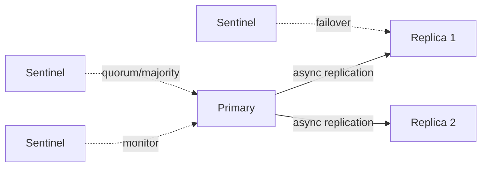

# Q045 · WAIT 能不能保证 Redis 强一致？

> **难度：** 高级  
> **所属章节：** 05 · 复制与 Sentinel 高可用  
> **PDF 对应页：** 53  
> **目标：** 先在 60 秒内给结论，再用机制、边界和生产验证把答案展开。

## 1. 30–60 秒面试标准回答

不能。`WAIT` 让客户端在写后等待一定数量 replicas 确认收到复制流，可提高写在故障时被保留的概率，但官方明确说明它不会把 Redis 转成强一致 CP 系统。

`SET order:42 paid`

`WAIT 2 100`

## 2. PDF 原理拆解

它不是共识协议； replica ACK 也不一定等于磁盘 fsync。 timeout 后业务仍要决定失败、重试或降级，网络分区/failover 仍有复杂窗口。

## 3. PDF 高频追问与答题抓手

- 追问 1 发生网络分区或节点重启时，这个结论还成立吗？

- 追问 2 哪些状态/指标能帮助你判断当前是否已经进入降级或全量同步？

答题抓手：一句话拿分：“WAIT 提高 durability/write safety，但不能改变 Redis 的一致性模型。”

## 4. PDF 易错点 / Gotchas

不要说 WAIT=同步复制=强一致；不要忽略 timeout 后客户端的语义。

## 5. PDF 工程落地

一句话拿分：“WAIT 提高 durability/write safety，但不能改变 Redis 的一致性模型。”

> **PDF 一句话拿分：** 不能。  
> **GitHub 增强版一句话：** `WAIT` 让客户端等待一定 replica ACK，从概率上缩小丢写窗口，但它没有共识、日志提交索引或多数派持久化语义，因此不能把系统提升为强一致 CP。


## 6. 深度扩展：从“会答”到“能设计”

`WAIT` 让客户端等待一定 replica ACK，从概率上缩小丢写窗口，但它没有共识、日志提交索引或多数派持久化语义，因此不能把系统提升为强一致 CP。

### 6.1 成本 / 复杂度模型

复制成本由写入字节率、网络 RTT/带宽、backlog 和全量同步概率决定。

### 6.2 生产判断框架

- HA 不是零丢写；先明确复制异步性，再讨论 failover。
- 把故障域（主机、机架、AZ）写入拓扑设计。

### 6.3 面试时应主动补出的边界

- 先说明当前结论成立的前提：数据规模、读写比、是否 Cluster、是否允许数据丢失/陈旧。
- 如果涉及集合或批处理，必须说明 Big Key、单次返回体积和核心执行路径阻塞风险。
- 如果涉及 HA/一致性，必须明确网络分区、进程崩溃和 failover 后的行为，而不是只描述正常路径。
- 如果涉及性能，优先给出可观测指标和验证实验，不用“Redis 很快”替代测量。

### 6.4 可观测与验证指标

- `replication lag / offsets`
- `full sync 次数`
- `backlog 利用与断线时长`
- `failover duration / write loss observation`

### 6.5 故障注入 / 实验设计

注入短暂断网与 primary kill，验证 partial/full resync、failover 时间和 acknowledged-write 窗口。

### 6.6 面试白板图



## 7. 进一步追问树

- 网络分区 30 秒时，客户端会观察到什么？
- 如何减少 full resync 和 failover 对前台流量的影响？


## 8. 可操作验证 / 命令示例

> 命令用于验证思路，生产环境执行前应评估数据规模、权限和阻塞风险。

```text
WAIT 2 100
```


## 9. 版本与实现注意

本题以 Redis Open Source 8.10.1（2026-08）为版本基线；经典语义与版本相关实现应分开表述。

> 内部编码、命令集合和新能力会随版本变化。面试中建议先给经典语义，再说明当前版本增量。

## 10. 100 分回答评分尺

| 档位 | 能力表现 |
|---|---|
| 60 分 | 能给出定义和主结论，但没有失效边界。 |
| 80 分 | 能解释关键机制、复杂度，并回答至少两层追问。 |
| 90 分 | 能画出数据流/状态机，说明故障竞态和监控指标。 |
| 100 分 | 能从 SLO、容量、成本与版本约束重新推导方案，并指出什么时候不该使用该方案。 |

## 11. 关联题目

- [Q044 · replication backlog 是干什么的？](q044.md)
- [Q046 · Redis Sentinel 是干什么的？](q046.md)
- [Q041 · Redis 主从复制是同步还是异步？](q041.md)
- [Q059 · Cluster 是强一致系统吗？](../06-cluster/q059.md)

## 12. 官方参考

- [Replication](https://redis.io/docs/latest/operate/oss_and_stack/management/replication/)
- [Sentinel](https://redis.io/docs/latest/operate/oss_and_stack/management/sentinel/)

## 13. 专业深挖补充（v2）

> **来源说明：** 第 1–5 节保留 PDF 母版主线；本节是 GitHub 增强内容，结合 Redis 官方文档、当前版本实现语义与生产工程实践扩展。

### 13.1 核心机制再推导

`WAIT` 等待一定数量 replica 确认已处理前序写，降低 failover 丢写概率，但它没有引入共识日志、任期提交规则或线性一致读，因此官方明确说不会让 Redis 变成强一致存储。

不要停留在“记住结论”。面试时建议把本题改写成一条因果链：

```text
业务目标 / SLO
  ↓
Redis 提供的原语或内部机制
  ↓
复杂度、内存、网络与一致性成本
  ↓
故障/扩容时的边界
  ↓
可观测指标与验证实验
```

### 13.2 复杂度、容量与性能模型

复制/HA 要同时量化 replication lag、可容忍断连窗口、failover time 与 acknowledged-write loss risk。

计算复杂度只说明算法增长趋势，生产还必须补充四个量：

1. **N 到底是什么**：key 数、member 数、字段数、请求数还是字节数；
2. **一次返回多少字节**：很多“查找 O(1)”最终被大 reply 的网络/序列化成本主导；
3. **最坏 key/slot/shard 多大**：平均值无法解释热点和尾延迟；
4. **背景任务是否叠加**：fork、rewrite、expire、eviction、reshard 都可能与前台 workload 竞争资源。

### 13.3 生产案例推演

订单写 Redis 后 `WAIT 1 50` 可提高这次写到达 replica 的概率；但网络分区/选主仍可能选择未包含该写的节点或出现其他一致性窗口。

面试中不要只说“可以这样做”，还应给出验收口径：

- 功能正确：正常路径和重试路径结果一致；
- 性能正确：用真实 value/member 分布测 p50/p99/p999；
- 故障正确：节点重启、超时、网络分区或消费者崩溃后状态可解释；
- 运维正确：有容量阈值、报警、回滚和恢复演练。

### 13.4 失败模式 / 什么时候不该这么做

不要把 `WAIT` 当“同步复制开关”；它是 data-safety improvement，不是 CP 证明。

进一步判断时，可以问自己：

- 这个方案是不是把问题从 Redis 转移到了客户端，却没有减少总体复杂度？
- 如果 key、QPS、成员数扩大 10～100 倍，是否出现不可分割的单点成本？
- 如果 primary 在最坏时刻故障，已经返回给用户的结果是否仍然成立？
- 如果 Redis 整层不可用，业务是 fail-open、fail-closed 还是降级到其他数据源？

### 13.5 源码阅读路线

建议从 **命令语义 → 数据结构 → 生命周期/故障路径** 三层阅读，而不是从 `server.c` 顺序翻完整仓库。

- 推荐入口：`src/replication.c`
- 第一步：在该 Redis 版本的 command table 中定位命令 handler；
- 第二步：跟到对象编码/数据结构操作，记录关键 Big-O 和可能的全量遍历；
- 第三步：继续追踪 replication、AOF/RDB、lazyfree、Cluster 等副作用；
- 第四步：对照官方命令页的 `time complexity`、版本变更与 ACL category。

> 源码路径属于阅读导航，不是稳定 API；升级 Redis 后应以目标 tag/commit 为准。

### 13.6 高频追问：标准应答

**追问 A：发生网络分区时，正常路径的结论还成立吗？**  
不一定。它不是共识协议；replica ACK 也不一定等于磁盘 fsync。timeout 后业务仍要决定失败、重试或降级，网络分区/failover 仍有复杂窗口。 所以回答必须把异步复制、majority/slot ownership 与可能的数据丢失窗口说清楚。

**追问 B：你会监控什么来提前发现风险？**  
至少看 replication lag/full sync、cluster_state、per-shard CPU/QPS、MOVED/ASK 和 failover 事件，而不是只看实例存活。

### 13.7 面试官继续深挖时的回答结构

可以按下面顺序组织 2～5 分钟回答：

1. **定义**：一句话说明它解决什么问题；
2. **机制**：画出数据流/状态机，说明 Redis 内部怎样实现；
3. **复杂度**：给 Big-O，同时指出 N 与 byte size；
4. **边界**：Big Key、Hot Key、Cluster、复制、故障时会怎样；
5. **方案**：为什么选它，而不是最相近的替代方案；
6. **验证**：给出线上指标、命令或故障注入；
7. **版本**：若是 Redis 8.x 新能力，明确最低版本和回滚兼容。

### 13.8 本题复习检查表

- [ ] 我能在 30 秒内说出结论，不堆命令名。
- [ ] 我能解释至少一个内部数据结构/状态机。
- [ ] 我能说出 Big-O，并解释规模变量是什么。
- [ ] 我能指出至少两个会失效的边界条件。
- [ ] 我能给出一个真实生产案例或故障时序。
- [ ] 我能给出 3 个以上可观测指标/验证手段。
- [ ] 我能说明 Redis Cluster / replication 对本题是否有额外约束。
- [ ] 我知道目标版本的官方文档入口：<https://redis.io/docs/latest/operate/oss_and_stack/management/replication/>。

---

← [Q044 replication backlog 是干什么的？](q044.md) | [章节索引](README.md) | [Q046 Redis Sentinel 是干什么的？](q046.md) →
