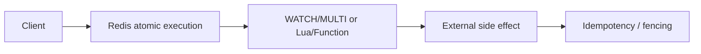

# Q061 · Redis 单个命令为什么可以认为是原子的？

> **难度：** 基础必会  
> **所属章节：** 07 · 事务、Lua、Functions 与分布式锁  
> **PDF 对应页：** 71  
> **目标：** 先在 60 秒内给结论，再用机制、边界和生产验证把答案展开。

## 1. 30–60 秒面试标准回答

对核心命令执行语义，一个命令不会被其他客户端普通命令插入到中间，因此 `INCR/HINCRBY/SET NX` 等能作为并发 primitive。单命令原子不代表多个 round trip 组成的客户端流程原子。

## 2. PDF 原理拆解

`GET -> compute -> SET` 存在 race； 复杂 read-modify-write 可用 Lua/Functions 或 WATCH/MULTI。 原子性也与 durability/replication consistency 不同，命令执行成功不等于绝不丢数据。

## 3. PDF 高频追问与答题抓手

- 追问 1 这个方案提供的是原子性、隔离性、至少一次，还是强一致？不要混淆哪些概念？

- 追问 2 如果客户端在关键步骤之间崩溃，应如何恢复或补偿？

答题抓手：并发题先问“能否压成单个 Redis 命令”，往往是最简单可靠的方案。

## 4. PDF 易错点 / Gotchas

不要把原子性扩展到多个命令；不要把原子等同于持久化。

## 5. PDF 工程落地

并发题先问“能否压成单个 Redis 命令”，往往是最简单可靠的方案。

> **PDF 一句话拿分：** 对核心命令执行语义，一个命令不会被其他客户端普通命令插入到中间，因此 `INCR/HINCRBY/SET NX` 等能作为并发 primitive。  
> **GitHub 增强版一句话：** 单个 Redis command 的原子性来自核心执行路径不被其他普通命令穿插，但多命令 read-modify-write 不自动原子。


## 6. 深度扩展：从“会答”到“能设计”

单个 Redis command 的原子性来自核心执行路径不被其他普通命令穿插，但多命令 read-modify-write 不自动原子。不要把“单命令原子”泛化成业务事务。

### 6.1 成本 / 复杂度模型

单命令原子性不改变命令自身复杂度；长 O(N) 命令仍会阻塞后续请求。

### 6.2 生产判断框架

- 原子性、隔离、持久性、租约与 exactly-once 是不同概念。
- 涉及外部系统副作用时，必须设计幂等或 fencing。

### 6.3 面试时应主动补出的边界

- 先说明当前结论成立的前提：数据规模、读写比、是否 Cluster、是否允许数据丢失/陈旧。
- 如果涉及集合或批处理，必须说明 Big Key、单次返回体积和核心执行路径阻塞风险。
- 如果涉及 HA/一致性，必须明确网络分区、进程崩溃和 failover 后的行为，而不是只描述正常路径。
- 如果涉及性能，优先给出可观测指标和验证实验，不用“Redis 很快”替代测量。

### 6.4 可观测与验证指标

- `script/function latency`
- `WATCH abort/retry rate`
- `lock acquisition latency/timeout`
- `duplicate/compensation events`

### 6.5 故障注入 / 实验设计

注入客户端暂停、超时和重复请求，验证 WATCH 重试、脚本超时、锁 token 与业务幂等/fencing。

### 6.6 面试白板图



## 7. 进一步追问树

- 客户端在关键步骤之间崩溃时如何补偿？
- 这个方案保证的是原子性、隔离性还是租约语义？


## 8. 可操作验证 / 命令示例

> 命令用于验证思路，生产环境执行前应评估数据规模、权限和阻塞风险。

```text
INCR counter
```


## 9. 版本与实现注意

本题以 Redis Open Source 8.10.1（2026-08）为版本基线；经典语义与版本相关实现应分开表述。

> 内部编码、命令集合和新能力会随版本变化。面试中建议先给经典语义，再说明当前版本增量。

## 10. 100 分回答评分尺

| 档位 | 能力表现 |
|---|---|
| 60 分 | 能给出定义和主结论，但没有失效边界。 |
| 80 分 | 能解释关键机制、复杂度，并回答至少两层追问。 |
| 90 分 | 能画出数据流/状态机，说明故障竞态和监控指标。 |
| 100 分 | 能从 SLO、容量、成本与版本约束重新推导方案，并指出什么时候不该使用该方案。 |

## 11. 关联题目

- [Q062 · MULTI/EXEC 是什么？](q062.md)
- [Q066 · Lua Script 为什么经常用于 Redis？](q066.md)

## 12. 官方参考

- [Transactions](https://redis.io/docs/latest/develop/using-commands/transactions/)
- [Pipelining](https://redis.io/docs/latest/develop/using-commands/pipelining/)
- [Locks](https://redis.io/docs/latest/develop/clients/patterns/distributed-locks/)

## 13. 专业深挖补充（v2）

> **来源说明：** 第 1–5 节保留 PDF 母版主线；本节是 GitHub 增强内容，结合 Redis 官方文档、当前版本实现语义与生产工程实践扩展。

### 13.1 核心机制再推导

单命令原子性来自核心命令执行期间不会被另一个普通命令交叉插入，但原子不等于“零成本”或“跨系统事务”。长命令仍会阻塞后续命令。

不要停留在“记住结论”。面试时建议把本题改写成一条因果链：

```text
业务目标 / SLO
  ↓
Redis 提供的原语或内部机制
  ↓
复杂度、内存、网络与一致性成本
  ↓
故障/扩容时的边界
  ↓
可观测指标与验证实验
```

### 13.2 复杂度、容量与性能模型

原子/事务题要明确“原子边界在哪里”：单命令、脚本、Redis 实例，还是跨 DB/服务；边界外都需要额外协议。

计算复杂度只说明算法增长趋势，生产还必须补充四个量：

1. **N 到底是什么**：key 数、member 数、字段数、请求数还是字节数；
2. **一次返回多少字节**：很多“查找 O(1)”最终被大 reply 的网络/序列化成本主导；
3. **最坏 key/slot/shard 多大**：平均值无法解释热点和尾延迟；
4. **背景任务是否叠加**：fork、rewrite、expire、eviction、reshard 都可能与前台 workload 竞争资源。

### 13.3 生产案例推演

`INCR` 不会 lost update；但 `GET`→应用计算→`SET` 是多个原子步骤拼起来的非原子业务过程。

面试中不要只说“可以这样做”，还应给出验收口径：

- 功能正确：正常路径和重试路径结果一致；
- 性能正确：用真实 value/member 分布测 p50/p99/p999；
- 故障正确：节点重启、超时、网络分区或消费者崩溃后状态可解释；
- 运维正确：有容量阈值、报警、回滚和恢复演练。

### 13.4 失败模式 / 什么时候不该这么做

不要把 Redis 单命令原子性推广成 DB+Redis 或多服务的一致性保证。

进一步判断时，可以问自己：

- 这个方案是不是把问题从 Redis 转移到了客户端，却没有减少总体复杂度？
- 如果 key、QPS、成员数扩大 10～100 倍，是否出现不可分割的单点成本？
- 如果 primary 在最坏时刻故障，已经返回给用户的结果是否仍然成立？
- 如果 Redis 整层不可用，业务是 fail-open、fail-closed 还是降级到其他数据源？

### 13.5 源码阅读路线

建议从 **命令语义 → 数据结构 → 生命周期/故障路径** 三层阅读，而不是从 `server.c` 顺序翻完整仓库。

- 推荐入口：对应 `src/t_*.c` 命令路径 + server command execution
- 第一步：在该 Redis 版本的 command table 中定位命令 handler；
- 第二步：跟到对象编码/数据结构操作，记录关键 Big-O 和可能的全量遍历；
- 第三步：继续追踪 replication、AOF/RDB、lazyfree、Cluster 等副作用；
- 第四步：对照官方命令页的 `time complexity`、版本变更与 ACL category。

> 源码路径属于阅读导航，不是稳定 API；升级 Redis 后应以目标 tag/commit 为准。

### 13.6 高频追问：标准应答

**追问 A：原子性到底覆盖到哪里？**  
只覆盖 Redis 定义的执行边界。对核心命令执行语义，一个命令不会被其他客户端普通命令插入到中间，因此 `INCR/HINCRBY/SET NX` 等能作为并发 primitive。单命令原子不代表多个 round trip 组成的客户端流程原子。 一旦副作用进入数据库、HTTP 或外部资源，就必须用幂等、版本或更强协调协议。

**追问 B：高并发下最常见的误用是什么？**  
不要把原子性扩展到多个命令；不要把原子等同于持久化。 还要给脚本/事务定义最大数据规模，避免“语义原子但执行时间失控”。

### 13.7 面试官继续深挖时的回答结构

可以按下面顺序组织 2～5 分钟回答：

1. **定义**：一句话说明它解决什么问题；
2. **机制**：画出数据流/状态机，说明 Redis 内部怎样实现；
3. **复杂度**：给 Big-O，同时指出 N 与 byte size；
4. **边界**：Big Key、Hot Key、Cluster、复制、故障时会怎样；
5. **方案**：为什么选它，而不是最相近的替代方案；
6. **验证**：给出线上指标、命令或故障注入；
7. **版本**：若是 Redis 8.x 新能力，明确最低版本和回滚兼容。

### 13.8 本题复习检查表

- [ ] 我能在 30 秒内说出结论，不堆命令名。
- [ ] 我能解释至少一个内部数据结构/状态机。
- [ ] 我能说出 Big-O，并解释规模变量是什么。
- [ ] 我能指出至少两个会失效的边界条件。
- [ ] 我能给出一个真实生产案例或故障时序。
- [ ] 我能给出 3 个以上可观测指标/验证手段。
- [ ] 我能说明 Redis Cluster / replication 对本题是否有额外约束。
- [ ] 我知道目标版本的官方文档入口：<https://redis.io/docs/latest/develop/using-commands/transactions/>。

---

← [Q060 Redis Cluster 最少为什么经常部署 6 个实例？](../06-cluster/q060.md) | [章节索引](README.md) | [Q062 MULTI/EXEC 是什么？](q062.md) →
