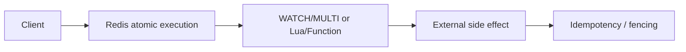

# Q064 · WATCH 是怎么实现乐观锁的？

> **难度：** 中级  
> **所属章节：** 07 · 事务、Lua、Functions 与分布式锁  
> **PDF 对应页：** 74  
> **目标：** 先在 60 秒内给结论，再用机制、边界和生产验证把答案展开。

## 1. 30–60 秒面试标准回答

`WATCH 监视一个或多个 key，在 `WATCH -> 读取/计算 -> MULTI/EXEC` 期间若 key 被别人改动，EXEC 会失败/放`

弃，客户端需要重新读取并重试，类似 CAS。

`WATCH balance`

`GET balance`

`MULTI`

`SET balance <new>`

`EXEC`

## 2. PDF 原理拆解

它不锁住 key，别人仍能正常写； 只是提交时验证前提是否仍成立。 冲突率高时大量 abort/retry 会降低效率，复杂逻辑常可比较 Lua/Functions。

## 3. PDF 高频追问与答题抓手

- 追问 1 这个方案提供的是原子性、隔离性、至少一次，还是强一致？不要混淆哪些概念？

- 追问 2 如果客户端在关键步骤之间崩溃，应如何恢复或补偿？

答题抓手：一句话：WATCH 不阻止别人写，只告诉你“你基于的旧状态已经失效”。

## 4. PDF 易错点 / Gotchas

不要把 WATCH 当悲观互斥锁；EXEC 失败后不能继续用旧读取结果重试。

## 5. PDF 工程落地

一句话：WATCH 不阻止别人写，只告诉你“你基于的旧状态已经失效”。

> **PDF 一句话拿分：** WATCH 监视一个或多个 key，在 `WATCH -> 读取/计算 -> MULTI/EXEC` 期间若 key 被别人改动，EXEC 会失 败/放弃，客户端需要重新读取并重试，类似 CAS。  
> **GitHub 增强版一句话：** WATCH 是 optimistic CAS：在 EXEC 前观察 key 是否发生变化。


## 6. 深度扩展：从“会答”到“能设计”

WATCH 是 optimistic CAS：在 EXEC 前观察 key 是否发生变化。竞争高时会频繁 abort/retry，因此它不是高冲突场景的免费锁。

### 6.1 成本 / 复杂度模型

原子/事务方案的关键成本是冲突、重试和核心线程阻塞时间，而不仅是命令数量。

### 6.2 生产判断框架

- 原子性、隔离、持久性、租约与 exactly-once 是不同概念。
- 涉及外部系统副作用时，必须设计幂等或 fencing。

### 6.3 面试时应主动补出的边界

- 先说明当前结论成立的前提：数据规模、读写比、是否 Cluster、是否允许数据丢失/陈旧。
- 如果涉及集合或批处理，必须说明 Big Key、单次返回体积和核心执行路径阻塞风险。
- 如果涉及 HA/一致性，必须明确网络分区、进程崩溃和 failover 后的行为，而不是只描述正常路径。
- 如果涉及性能，优先给出可观测指标和验证实验，不用“Redis 很快”替代测量。

### 6.4 可观测与验证指标

- `script/function latency`
- `WATCH abort/retry rate`
- `lock acquisition latency/timeout`
- `duplicate/compensation events`

### 6.5 故障注入 / 实验设计

注入客户端暂停、超时和重复请求，验证 WATCH 重试、脚本超时、锁 token 与业务幂等/fencing。

### 6.6 面试白板图



## 7. 进一步追问树

- 客户端在关键步骤之间崩溃时如何补偿？
- 这个方案保证的是原子性、隔离性还是租约语义？


## 8. 可操作验证 / 命令示例

> 命令用于验证思路，生产环境执行前应评估数据规模、权限和阻塞风险。

```text
WATCH balance
GET balance
MULTI
SET balance 99
EXEC
```


## 9. 版本与实现注意

本题以 Redis Open Source 8.10.1（2026-08）为版本基线；经典语义与版本相关实现应分开表述。

> 内部编码、命令集合和新能力会随版本变化。面试中建议先给经典语义，再说明当前版本增量。

## 10. 100 分回答评分尺

| 档位 | 能力表现 |
|---|---|
| 60 分 | 能给出定义和主结论，但没有失效边界。 |
| 80 分 | 能解释关键机制、复杂度，并回答至少两层追问。 |
| 90 分 | 能画出数据流/状态机，说明故障竞态和监控指标。 |
| 100 分 | 能从 SLO、容量、成本与版本约束重新推导方案，并指出什么时候不该使用该方案。 |

## 11. 关联题目

- [Q063 · Redis Transaction 支持 rollback 吗？](q063.md)
- [Q065 · Pipeline 和 Transaction 有什么区别？](q065.md)
- [Q062 · MULTI/EXEC 是什么？](q062.md)
- [Q069 · 怎么正确实现单 Redis 实例分布式锁？](q069.md)

## 12. 官方参考

- [Transactions](https://redis.io/docs/latest/develop/using-commands/transactions/)
- [Pipelining](https://redis.io/docs/latest/develop/using-commands/pipelining/)
- [Locks](https://redis.io/docs/latest/develop/clients/patterns/distributed-locks/)

## 13. 专业深挖补充（v2）

> **来源说明：** 第 1–5 节保留 PDF 母版主线；本节是 GitHub 增强内容，结合 Redis 官方文档、当前版本实现语义与生产工程实践扩展。

### 13.1 核心机制再推导

WATCH 是 optimistic concurrency control：记录被观察 key，在 EXEC 前若 key 被修改/过期/淘汰等造成版本变化，事务放弃执行，由客户端重试。

不要停留在“记住结论”。面试时建议把本题改写成一条因果链：

```text
业务目标 / SLO
  ↓
Redis 提供的原语或内部机制
  ↓
复杂度、内存、网络与一致性成本
  ↓
故障/扩容时的边界
  ↓
可观测指标与验证实验
```

### 13.2 复杂度、容量与性能模型

原子/事务题要明确“原子边界在哪里”：单命令、脚本、Redis 实例，还是跨 DB/服务；边界外都需要额外协议。

计算复杂度只说明算法增长趋势，生产还必须补充四个量：

1. **N 到底是什么**：key 数、member 数、字段数、请求数还是字节数；
2. **一次返回多少字节**：很多“查找 O(1)”最终被大 reply 的网络/序列化成本主导；
3. **最坏 key/slot/shard 多大**：平均值无法解释热点和尾延迟；
4. **背景任务是否叠加**：fork、rewrite、expire、eviction、reshard 都可能与前台 workload 竞争资源。

### 13.3 生产案例推演

余额更新读取后做复杂计算，可 WATCH balance；冲突低时性能很好，冲突高时重试风暴会让它不合适。

面试中不要只说“可以这样做”，还应给出验收口径：

- 功能正确：正常路径和重试路径结果一致；
- 性能正确：用真实 value/member 分布测 p50/p99/p999；
- 故障正确：节点重启、超时、网络分区或消费者崩溃后状态可解释；
- 运维正确：有容量阈值、报警、回滚和恢复演练。

### 13.4 失败模式 / 什么时候不该这么做

WATCH 不是锁，不阻止别人写；客户端必须正确处理 EXEC 返回空并重试/退出。

进一步判断时，可以问自己：

- 这个方案是不是把问题从 Redis 转移到了客户端，却没有减少总体复杂度？
- 如果 key、QPS、成员数扩大 10～100 倍，是否出现不可分割的单点成本？
- 如果 primary 在最坏时刻故障，已经返回给用户的结果是否仍然成立？
- 如果 Redis 整层不可用，业务是 fail-open、fail-closed 还是降级到其他数据源？

### 13.5 源码阅读路线

建议从 **命令语义 → 数据结构 → 生命周期/故障路径** 三层阅读，而不是从 `server.c` 顺序翻完整仓库。

- 推荐入口：`src/multi.c` + watched keys 相关逻辑
- 第一步：在该 Redis 版本的 command table 中定位命令 handler；
- 第二步：跟到对象编码/数据结构操作，记录关键 Big-O 和可能的全量遍历；
- 第三步：继续追踪 replication、AOF/RDB、lazyfree、Cluster 等副作用；
- 第四步：对照官方命令页的 `time complexity`、版本变更与 ACL category。

> 源码路径属于阅读导航，不是稳定 API；升级 Redis 后应以目标 tag/commit 为准。

### 13.6 高频追问：标准应答

**追问 A：原子性到底覆盖到哪里？**  
只覆盖 Redis 定义的执行边界。WATCH 监视一个或多个 key，在 `WATCH -> 读取/计算 -> MULTI/EXEC` 期间若 key 被别人改动，EXEC 会失败/放弃，客户端需要重新读取并重试，类似 CAS。 一旦副作用进入数据库、HTTP 或外部资源，就必须用幂等、版本或更强协调协议。

**追问 B：高并发下最常见的误用是什么？**  
不要把 WATCH 当悲观互斥锁；EXEC 失败后不能继续用旧读取结果重试。 还要给脚本/事务定义最大数据规模，避免“语义原子但执行时间失控”。

### 13.7 面试官继续深挖时的回答结构

可以按下面顺序组织 2～5 分钟回答：

1. **定义**：一句话说明它解决什么问题；
2. **机制**：画出数据流/状态机，说明 Redis 内部怎样实现；
3. **复杂度**：给 Big-O，同时指出 N 与 byte size；
4. **边界**：Big Key、Hot Key、Cluster、复制、故障时会怎样；
5. **方案**：为什么选它，而不是最相近的替代方案；
6. **验证**：给出线上指标、命令或故障注入；
7. **版本**：若是 Redis 8.x 新能力，明确最低版本和回滚兼容。

### 13.8 本题复习检查表

- [ ] 我能在 30 秒内说出结论，不堆命令名。
- [ ] 我能解释至少一个内部数据结构/状态机。
- [ ] 我能说出 Big-O，并解释规模变量是什么。
- [ ] 我能指出至少两个会失效的边界条件。
- [ ] 我能给出一个真实生产案例或故障时序。
- [ ] 我能给出 3 个以上可观测指标/验证手段。
- [ ] 我能说明 Redis Cluster / replication 对本题是否有额外约束。
- [ ] 我知道目标版本的官方文档入口：<https://redis.io/docs/latest/develop/using-commands/transactions/>。

---

← [Q063 Redis Transaction 支持 rollback 吗？](q063.md) | [章节索引](README.md) | [Q065 Pipeline 和 Transaction 有什么区别？](q065.md) →
