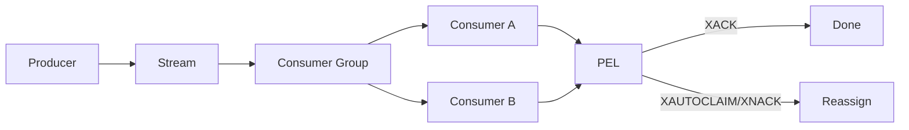

# Q071 · Redis Pub/Sub 的特点是什么？

> **难度：** 基础必会  
> **所属章节：** 08 · Pub/Sub、Streams 与消息处理  
> **PDF 对应页：** 82  
> **目标：** 先在 60 秒内给结论，再用机制、边界和生产验证把答案展开。

## 1. 30–60 秒面试标准回答

Pub/Sub 是实时广播模型：publisher 发布到 channel，在线 subscribers 立即接收。它简单、低延迟，但普通 Pub/Sub 不保存历史，离线订阅者不会在重连后补收期间消息。

## 2. PDF 原理拆解

适合在线通知、缓存失效、实时事件提示； 不适合必须可靠处理、可重放的订单/支付事件。 ACK、pending、replay 不是普通 Pub/Sub 核心语义。

## 3. PDF 高频追问与答题抓手

- 追问 1 这个方案提供的是原子性、隔离性、至少一次，还是强一致？不要混淆哪些概念？

- 追问 2 如果客户端在关键步骤之间崩溃，应如何恢复或补偿？

答题抓手：如果需求写着“不能丢、要重放”，普通 Pub/Sub 基本应排除。

## 4. PDF 易错点 / Gotchas

不要把 Pub/Sub 当持久消息队列；不要忽略慢订阅者和客户端输出缓冲。

## 5. PDF 工程落地

如果需求写着“不能丢、要重放”，普通 Pub/Sub 基本应排除。

> **PDF 一句话拿分：** Pub/Sub 是实时广播模型：publisher 发布到 channel，在线 subscribers 立即接收。  
> **GitHub 增强版一句话：** Pub/Sub 是即时广播而不是持久日志。


## 6. 深度扩展：从“会答”到“能设计”

Pub/Sub 是即时广播而不是持久日志。订阅者离线时消息不会为其排队，因此只适合允许丢失/在线通知的场景。

### 6.1 成本 / 复杂度模型

消息成本由消息大小、consumer 数、pending/retention 和重试率共同决定。

### 6.2 生产判断框架

- 消息投递语义与业务效果语义要分开。
- 监控 lag、PEL、delivery count、毒消息与 retention。

### 6.3 面试时应主动补出的边界

- 先说明当前结论成立的前提：数据规模、读写比、是否 Cluster、是否允许数据丢失/陈旧。
- 如果涉及集合或批处理，必须说明 Big Key、单次返回体积和核心执行路径阻塞风险。
- 如果涉及 HA/一致性，必须明确网络分区、进程崩溃和 failover 后的行为，而不是只描述正常路径。
- 如果涉及性能，优先给出可观测指标和验证实验，不用“Redis 很快”替代测量。

### 6.4 可观测与验证指标

- `stream lag`
- `PEL size / idle / delivery count`
- `consumer throughput / retry rate`
- `stream length / retention bytes`

### 6.5 故障注入 / 实验设计

杀掉正在处理 pending 的 consumer，再启动新 consumer，验证 XAUTOCLAIM/XNACK、重复投递和幂等。

### 6.6 面试白板图



## 7. 进一步追问树

- 消费者重复处理时如何保证业务幂等？
- 如何监控 backlog、PEL 和毒消息？


## 8. 可操作验证 / 命令示例

> 命令用于验证思路，生产环境执行前应评估数据规模、权限和阻塞风险。

```text
PUBLISH news "hello"
SUBSCRIBE news
```


## 9. 版本与实现注意

本题以 Redis Open Source 8.10.1（2026-08）为版本基线；经典语义与版本相关实现应分开表述。

> 内部编码、命令集合和新能力会随版本变化。面试中建议先给经典语义，再说明当前版本增量。

## 10. 100 分回答评分尺

| 档位 | 能力表现 |
|---|---|
| 60 分 | 能给出定义和主结论，但没有失效边界。 |
| 80 分 | 能解释关键机制、复杂度，并回答至少两层追问。 |
| 90 分 | 能画出数据流/状态机，说明故障竞态和监控指标。 |
| 100 分 | 能从 SLO、容量、成本与版本约束重新推导方案，并指出什么时候不该使用该方案。 |

## 11. 关联题目

- [Q072 · Pub/Sub 和 Stream 最大区别是什么？](q072.md)
- [Q080 · Redis 和 Kafka 应该怎么选？](q080.md)

## 12. 官方参考

- [Pubsub](https://redis.io/docs/latest/develop/pubsub/)
- [Streams](https://redis.io/docs/latest/develop/data-types/streams/)

## 13. 专业深挖补充（v2）

> **来源说明：** 第 1–5 节保留 PDF 母版主线；本节是 GitHub 增强内容，结合 Redis 官方文档、当前版本实现语义与生产工程实践扩展。

### 13.1 核心机制再推导

Pub/Sub 是瞬时 fan-out：服务器把发布时在线的消息推给订阅者，不为离线消费者维护可重放历史。它适合通知而不是可靠任务日志。

不要停留在“记住结论”。面试时建议把本题改写成一条因果链：

```text
业务目标 / SLO
  ↓
Redis 提供的原语或内部机制
  ↓
复杂度、内存、网络与一致性成本
  ↓
故障/扩容时的边界
  ↓
可观测指标与验证实验
```

### 13.2 复杂度、容量与性能模型

消息系统同时量化生产速率、消费速率、lag、pending、retention、重复率和恢复时间。

计算复杂度只说明算法增长趋势，生产还必须补充四个量：

1. **N 到底是什么**：key 数、member 数、字段数、请求数还是字节数；
2. **一次返回多少字节**：很多“查找 O(1)”最终被大 reply 的网络/序列化成本主导；
3. **最坏 key/slot/shard 多大**：平均值无法解释热点和尾延迟；
4. **背景任务是否叠加**：fork、rewrite、expire、eviction、reshard 都可能与前台 workload 竞争资源。

### 13.3 生产案例推演

缓存失效广播、在线状态通知可以 Pub/Sub；订单扣款事件如果消费者重启后必须补处理，则不应只用 Pub/Sub。

面试中不要只说“可以这样做”，还应给出验收口径：

- 功能正确：正常路径和重试路径结果一致；
- 性能正确：用真实 value/member 分布测 p50/p99/p999；
- 故障正确：节点重启、超时、网络分区或消费者崩溃后状态可解释；
- 运维正确：有容量阈值、报警、回滚和恢复演练。

### 13.4 失败模式 / 什么时候不该这么做

不要把 subscriber 断线期间消息当作会自动补发，也不要把 Pub/Sub 描述成 durable queue。

进一步判断时，可以问自己：

- 这个方案是不是把问题从 Redis 转移到了客户端，却没有减少总体复杂度？
- 如果 key、QPS、成员数扩大 10～100 倍，是否出现不可分割的单点成本？
- 如果 primary 在最坏时刻故障，已经返回给用户的结果是否仍然成立？
- 如果 Redis 整层不可用，业务是 fail-open、fail-closed 还是降级到其他数据源？

### 13.5 源码阅读路线

建议从 **命令语义 → 数据结构 → 生命周期/故障路径** 三层阅读，而不是从 `server.c` 顺序翻完整仓库。

- 推荐入口：Pub/Sub 相关命令/订阅管理实现
- 第一步：在该 Redis 版本的 command table 中定位命令 handler；
- 第二步：跟到对象编码/数据结构操作，记录关键 Big-O 和可能的全量遍历；
- 第三步：继续追踪 replication、AOF/RDB、lazyfree、Cluster 等副作用；
- 第四步：对照官方命令页的 `time complexity`、版本变更与 ACL category。

> 源码路径属于阅读导航，不是稳定 API；升级 Redis 后应以目标 tag/commit 为准。

### 13.6 高频追问：标准应答

**追问 A：消费者崩溃后如何保证任务不会静默丢失？**  
适合在线通知、缓存失效、实时事件提示；不适合必须可靠处理、可重放的订单/支付事件。ACK、pending、replay 不是普通 Pub/Sub 核心语义。 可靠消费还必须配幂等 event_id 和 pending/lag 监控。

**追问 B：什么时候应该换 Kafka/专用 MQ？**  
当 retention、跨团队事件总线、TB/PB 历史、分区扩展和大规模 replay 成为核心需求时，应优先选择以持久日志为中心的系统。

### 13.7 面试官继续深挖时的回答结构

可以按下面顺序组织 2～5 分钟回答：

1. **定义**：一句话说明它解决什么问题；
2. **机制**：画出数据流/状态机，说明 Redis 内部怎样实现；
3. **复杂度**：给 Big-O，同时指出 N 与 byte size；
4. **边界**：Big Key、Hot Key、Cluster、复制、故障时会怎样；
5. **方案**：为什么选它，而不是最相近的替代方案；
6. **验证**：给出线上指标、命令或故障注入；
7. **版本**：若是 Redis 8.x 新能力，明确最低版本和回滚兼容。

### 13.8 本题复习检查表

- [ ] 我能在 30 秒内说出结论，不堆命令名。
- [ ] 我能解释至少一个内部数据结构/状态机。
- [ ] 我能说出 Big-O，并解释规模变量是什么。
- [ ] 我能指出至少两个会失效的边界条件。
- [ ] 我能给出一个真实生产案例或故障时序。
- [ ] 我能给出 3 个以上可观测指标/验证手段。
- [ ] 我能说明 Redis Cluster / replication 对本题是否有额外约束。
- [ ] 我知道目标版本的官方文档入口：<https://redis.io/docs/latest/develop/data-types/streams/>。

---

← [Q070 Redlock 是否绝对安全？](../07-transactions-locks/q070.md) | [章节索引](README.md) | [Q072 Pub/Sub 和 Stream 最大区别是什么？](q072.md) →
