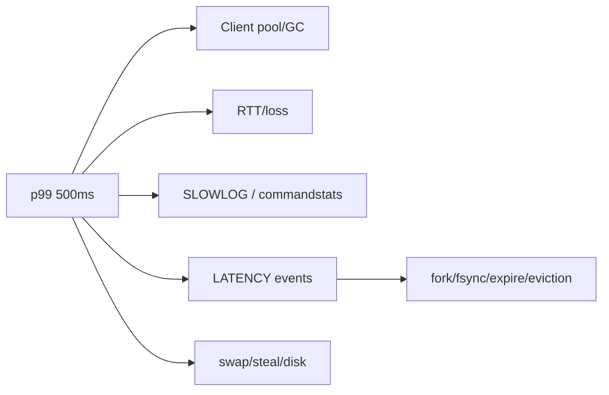

# Q083 · Redis 延迟突然从 1 ms 变成 500 ms，怎么排查？

> **难度：** 高级  
> **所属章节：** 09 · 性能诊断、运维与安全  
> **PDF 对应页：** 95  
> **目标：** 先在 60 秒内给结论，再用机制、边界和生产验证把答案展开。

## 1. 30–60 秒面试标准回答

按 client -> network -> Redis -> OS 分层，而不是一上来只看 SLOWLOG。客户端查连接池、GC、DNS；网络查 RTT/丢包；Redis 查 SLOWLOG、LATENCY、commandstats、Big/Hot Key；OS/持久化查 fork、AOF fsync、swap、

`CPU steal、磁盘抖动。`

`SLOWLOG GET 128`

`LATENCY LATEST`

`LATENCY DOCTOR`

`INFO commandstats`

## 2. PDF 原理拆解

`SLOWLOG 干净不代表端到端没问题；`

延迟尖刺若与 `latest_fork_usec`、AOF event、expire/eviction cycle 同时出现，应重点查内核和后台任务。 务必关注 p99/p999 而非平均值。

## 3. PDF 高频追问与答题抓手

- 追问 1 如果 SLOWLOG 没有异常，但客户端 p99 很高，你下一步查什么？

- 追问 2 fork/AOF/expire/eviction 如何进入同一套延迟诊断？

答题抓手：排障回答最好呈现一条因果路径和验证步骤，而不是堆工具名。

## 4. PDF 易错点 / Gotchas

不要看到 500ms 就直接扩容；不要只看 Redis CPU。

## 5. PDF 工程落地

排障回答最好呈现一条因果路径和验证步骤，而不是堆工具名。

> **PDF 一句话拿分：** 按 client -> network -> Redis -> OS 分层，而不是一上来只看 SLOWLOG。  
> **GitHub 增强版一句话：** 延迟排查必须从端到端分层：client、network、Redis、OS/后台任务。


## 6. 深度扩展：从“会答”到“能设计”

延迟排查必须从端到端分层：client、network、Redis、OS/后台任务。关键是把 p99 时间点与 SLOWLOG、LATENCY event、fork、fsync、expire/eviction 对齐，而不是只看平均 CPU。

### 6.1 成本 / 复杂度模型

运维问题更适合用“资源/时间成本模型”而非单一 Big-O；必须关注 p99/p999 与周期性后台事件。

### 6.2 生产判断框架

- 排障要按时间轴和层次验证假设，而不是堆命令。
- 保留证据优先于“先重启看看”。

### 6.3 面试时应主动补出的边界

- 先说明当前结论成立的前提：数据规模、读写比、是否 Cluster、是否允许数据丢失/陈旧。
- 如果涉及集合或批处理，必须说明 Big Key、单次返回体积和核心执行路径阻塞风险。
- 如果涉及 HA/一致性，必须明确网络分区、进程崩溃和 failover 后的行为，而不是只描述正常路径。
- 如果涉及性能，优先给出可观测指标和验证实验，不用“Redis 很快”替代测量。

### 6.4 可观测与验证指标

- `p50/p95/p99/p999`
- `SLOWLOG / LATENCY events`
- `CPU steal / swap / disk latency`
- `client connections / output buffers`

### 6.5 故障注入 / 实验设计

将故障事件与时间轴绑定：制造慢命令/CPU 压力/fork，确认监控是否能区分客户端、网络、Redis 与 OS 根因。

### 6.6 面试白板图



## 7. 进一步追问树

- 如何用时间相关性证明 fork 是根因而不是巧合？
- 如果只有一个 shard p99 高，应优先查哪些指标？
- 什么证据能证明你的根因假设？
- 如何把一次事故转成长期 guardrail？


## 8. 可操作验证 / 命令示例

> 命令用于验证思路，生产环境执行前应评估数据规模、权限和阻塞风险。

```text
SLOWLOG GET 128
LATENCY LATEST
LATENCY DOCTOR
INFO commandstats
```


## 9. 版本与实现注意

本题以 Redis Open Source 8.10.1（2026-08）为版本基线；经典语义与版本相关实现应分开表述。

> 内部编码、命令集合和新能力会随版本变化。面试中建议先给经典语义，再说明当前版本增量。

## 10. 100 分回答评分尺

| 档位 | 能力表现 |
|---|---|
| 60 分 | 能给出定义和主结论，但没有失效边界。 |
| 80 分 | 能解释关键机制、复杂度，并回答至少两层追问。 |
| 90 分 | 能画出数据流/状态机，说明故障竞态和监控指标。 |
| 100 分 | 能从 SLO、容量、成本与版本约束重新推导方案，并指出什么时候不该使用该方案。 |

## 11. 关联题目

- [Q082 · SCAN 会不会漏 Key 或重复 Key？](q082.md)
- [Q084 · SLOWLOG 记录的是网络耗时吗？](q084.md)
- [Q086 · Redis CPU 100%，最先看什么？](q086.md)
- [Q090 · Redis 监控最重要的指标有哪些？](q090.md)

## 12. 官方参考

- [Latency](https://redis.io/docs/latest/operate/oss_and_stack/management/optimization/latency/)
- [Latency Monitor](https://redis.io/docs/latest/operate/oss_and_stack/management/optimization/latency-monitor/)
- [Cli](https://redis.io/docs/latest/develop/tools/cli/)

## 13. 专业深挖补充（v2）

> **来源说明：** 第 1–5 节保留 PDF 母版主线；本节是 GitHub 增强内容，结合 Redis 官方文档、当前版本实现语义与生产工程实践扩展。

### 13.1 核心机制再推导

延迟排查应先回答“客户端慢还是服务器慢”。拆为 client pool/GC、网络 RTT、服务器排队/执行、后台事件、OS I/O/CPU，再用 SLOWLOG/LATENCY/INFO/系统指标逐层排除。

不要停留在“记住结论”。面试时建议把本题改写成一条因果链：

```text
业务目标 / SLO
  ↓
Redis 提供的原语或内部机制
  ↓
复杂度、内存、网络与一致性成本
  ↓
故障/扩容时的边界
  ↓
可观测指标与验证实验
```

### 13.2 复杂度、容量与性能模型

性能诊断用 tail latency、per-shard saturation 和资源 headroom 建模，平均值只做辅助。

计算复杂度只说明算法增长趋势，生产还必须补充四个量：

1. **N 到底是什么**：key 数、member 数、字段数、请求数还是字节数；
2. **一次返回多少字节**：很多“查找 O(1)”最终被大 reply 的网络/序列化成本主导；
3. **最坏 key/slot/shard 多大**：平均值无法解释热点和尾延迟；
4. **背景任务是否叠加**：fork、rewrite、expire、eviction、reshard 都可能与前台 workload 竞争资源。

### 13.3 生产案例推演

p99 500ms、SLOWLOG 无记录但 LATENCY 有 `fork`，说明不是某命令 CPU 慢；若 server latency 正常而客户端慢，再查连接池、DNS、GC。

面试中不要只说“可以这样做”，还应给出验收口径：

- 功能正确：正常路径和重试路径结果一致；
- 性能正确：用真实 value/member 分布测 p50/p99/p999；
- 故障正确：节点重启、超时、网络分区或消费者崩溃后状态可解释；
- 运维正确：有容量阈值、报警、回滚和恢复演练。

### 13.4 失败模式 / 什么时候不该这么做

不要一上来重启 Redis；重启会抹掉部分现场证据并掩盖真正触发条件。

进一步判断时，可以问自己：

- 这个方案是不是把问题从 Redis 转移到了客户端，却没有减少总体复杂度？
- 如果 key、QPS、成员数扩大 10～100 倍，是否出现不可分割的单点成本？
- 如果 primary 在最坏时刻故障，已经返回给用户的结果是否仍然成立？
- 如果 Redis 整层不可用，业务是 fail-open、fail-closed 还是降级到其他数据源？

### 13.5 源码阅读路线

建议从 **命令语义 → 数据结构 → 生命周期/故障路径** 三层阅读，而不是从 `server.c` 顺序翻完整仓库。

- 推荐入口：`src/latency.c`, `src/slowlog.c`, `src/server.c`
- 第一步：在该 Redis 版本的 command table 中定位命令 handler；
- 第二步：跟到对象编码/数据结构操作，记录关键 Big-O 和可能的全量遍历；
- 第三步：继续追踪 replication、AOF/RDB、lazyfree、Cluster 等副作用；
- 第四步：对照官方命令页的 `time complexity`、版本变更与 ACL category。

> 源码路径属于阅读导航，不是稳定 API；升级 Redis 后应以目标 tag/commit 为准。

### 13.6 高频追问：标准应答

**追问 A：你怎么区分“Redis 慢”和“客户端看到慢”？**  
把端到端时延拆成客户端排队/GC、网络、服务器执行与排队、后台事件和 OS；用 SLOWLOG、LATENCY、INFO 和主机指标做证据链。

**追问 B：为什么平均指标会误导？**  
SLOWLOG 干净不代表端到端没问题；延迟尖刺若与 `latest_fork_usec`、AOF event、expire/eviction cycle 同时出现，应重点查内核和后台任务。务必关注 p99/p999 而非平均值。 生产 Redis 更应关注 p99/p999、最热 shard、最大 key/reply 和资源峰值。

### 13.7 面试官继续深挖时的回答结构

可以按下面顺序组织 2～5 分钟回答：

1. **定义**：一句话说明它解决什么问题；
2. **机制**：画出数据流/状态机，说明 Redis 内部怎样实现；
3. **复杂度**：给 Big-O，同时指出 N 与 byte size；
4. **边界**：Big Key、Hot Key、Cluster、复制、故障时会怎样；
5. **方案**：为什么选它，而不是最相近的替代方案；
6. **验证**：给出线上指标、命令或故障注入；
7. **版本**：若是 Redis 8.x 新能力，明确最低版本和回滚兼容。

### 13.8 本题复习检查表

- [ ] 我能在 30 秒内说出结论，不堆命令名。
- [ ] 我能解释至少一个内部数据结构/状态机。
- [ ] 我能说出 Big-O，并解释规模变量是什么。
- [ ] 我能指出至少两个会失效的边界条件。
- [ ] 我能给出一个真实生产案例或故障时序。
- [ ] 我能给出 3 个以上可观测指标/验证手段。
- [ ] 我能说明 Redis Cluster / replication 对本题是否有额外约束。
- [ ] 我知道目标版本的官方文档入口：<https://redis.io/docs/latest/operate/oss_and_stack/management/optimization/latency/>。

---

← [Q082 SCAN 会不会漏 Key 或重复 Key？](q082.md) | [章节索引](README.md) | [Q084 SLOWLOG 记录的是网络耗时吗？](q084.md) →
