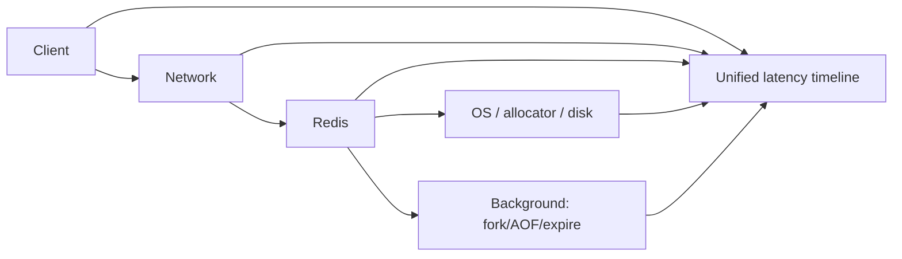

# Q089 · Redis 应该怎么做安全控制？

> **难度：** 基础必会  
> **所属章节：** 09 · 性能诊断、运维与安全  
> **PDF 对应页：** 101  
> **目标：** 先在 60 秒内给结论，再用机制、边界和生产验证把答案展开。

## 1. 30–60 秒面试标准回答

生产最低线包括私网/防火墙、ACL 最小权限、TLS、凭据轮换、危险命令/管理面限制、审计、备份保护和及时安全升级；Redis 不应直接暴露公网。

## 2. PDF 原理拆解

`ACL 可限制用户命令类别和 key pattern。`

Redis 8.10.1 在 2026 年 8 月包含多项安全修复，说明“在内网”也不能成为长期不升级的理由。

## 3. PDF 高频追问与答题抓手

- 追问 1 你会用哪些指标或实验验证这个方案，而不是凭经验判断？

- 追问 2 当 p99、内存或可用性目标冲突时，你会如何做权衡？

答题抓手：用 defense-in-depth 结构答：网络、身份、权限、传输、补丁、审计、备份。

## 4. PDF 易错点 / Gotchas

不要认为“有密码就能暴露公网”；不要给默认用户全命令权限。

## 5. PDF 工程落地

用 defense-in-depth 结构答：网络、身份、权限、传输、补丁、审计、备份。

> **PDF 一句话拿分：** 生产最低线包括私网/防火墙、ACL 最小权限、TLS、凭据轮换、危险命令/管理面限制、审计、备份保护和及时安全升级；Redis 不应直接暴露公网。  
> **GitHub 增强版一句话：** 安全基线包括网络隔离、ACL、TLS、最小权限、凭证轮换、危险命令治理与及时安全升级。


## 6. 深度扩展：从“会答”到“能设计”

安全基线包括网络隔离、ACL、TLS、最小权限、凭证轮换、危险命令治理与及时安全升级。Redis 8.10.1 是安全更新，版本管理本身就是安全控制的一部分。

### 6.1 成本 / 复杂度模型

运维问题更适合用“资源/时间成本模型”而非单一 Big-O；必须关注 p99/p999 与周期性后台事件。

### 6.2 生产判断框架

- 排障要按时间轴和层次验证假设，而不是堆命令。
- 保留证据优先于“先重启看看”。

### 6.3 面试时应主动补出的边界

- 先说明当前结论成立的前提：数据规模、读写比、是否 Cluster、是否允许数据丢失/陈旧。
- 如果涉及集合或批处理，必须说明 Big Key、单次返回体积和核心执行路径阻塞风险。
- 如果涉及 HA/一致性，必须明确网络分区、进程崩溃和 failover 后的行为，而不是只描述正常路径。
- 如果涉及性能，优先给出可观测指标和验证实验，不用“Redis 很快”替代测量。

### 6.4 可观测与验证指标

- `p50/p95/p99/p999`
- `SLOWLOG / LATENCY events`
- `CPU steal / swap / disk latency`
- `client connections / output buffers`

### 6.5 故障注入 / 实验设计

将故障事件与时间轴绑定：制造慢命令/CPU 压力/fork，确认监控是否能区分客户端、网络、Redis 与 OS 根因。

### 6.6 面试白板图



## 7. 进一步追问树

- 什么证据能证明你的根因假设？
- 如何把一次事故转成长期 guardrail？


## 8. 可操作验证 / 命令示例

> 命令用于验证思路，生产环境执行前应评估数据规模、权限和阻塞风险。

```text
ACL LIST
ACL CAT
ACL WHOAMI
```


## 9. 版本与实现注意

版本基线为 Redis Open Source 8.10.1（2026-08），该版本包含安全修复。

> 内部编码、命令集合和新能力会随版本变化。面试中建议先给经典语义，再说明当前版本增量。

## 10. 100 分回答评分尺

| 档位 | 能力表现 |
|---|---|
| 60 分 | 能给出定义和主结论，但没有失效边界。 |
| 80 分 | 能解释关键机制、复杂度，并回答至少两层追问。 |
| 90 分 | 能画出数据流/状态机，说明故障竞态和监控指标。 |
| 100 分 | 能从 SLO、容量、成本与版本约束重新推导方案，并指出什么时候不该使用该方案。 |

## 11. 关联题目

- [Q088 · 为什么 Redis 不应该使用 Swap？](q088.md)
- [Q090 · Redis 监控最重要的指标有哪些？](q090.md)
- [Q091 · Redis 8 最大的架构变化是什么？](../10-redis8-system-design/q091.md)

## 12. 官方参考

- [Latency](https://redis.io/docs/latest/operate/oss_and_stack/management/optimization/latency/)
- [Latency Monitor](https://redis.io/docs/latest/operate/oss_and_stack/management/optimization/latency-monitor/)
- [Cli](https://redis.io/docs/latest/develop/tools/cli/)

## 13. 专业深挖补充（v2）

> **来源说明：** 第 1–5 节保留 PDF 母版主线；本节是 GitHub 增强内容，结合 Redis 官方文档、当前版本实现语义与生产工程实践扩展。

### 13.1 核心机制再推导

Redis 安全应按层设计：网络隔离/TLS、ACL 最小权限、凭证轮换、危险命令治理、审计、补丁与备份。Redis 不应裸露在公网依赖一个密码。

不要停留在“记住结论”。面试时建议把本题改写成一条因果链：

```text
业务目标 / SLO
  ↓
Redis 提供的原语或内部机制
  ↓
复杂度、内存、网络与一致性成本
  ↓
故障/扩容时的边界
  ↓
可观测指标与验证实验
```

### 13.2 复杂度、容量与性能模型

性能诊断用 tail latency、per-shard saturation 和资源 headroom 建模，平均值只做辅助。

计算复杂度只说明算法增长趋势，生产还必须补充四个量：

1. **N 到底是什么**：key 数、member 数、字段数、请求数还是字节数；
2. **一次返回多少字节**：很多“查找 O(1)”最终被大 reply 的网络/序列化成本主导；
3. **最坏 key/slot/shard 多大**：平均值无法解释热点和尾延迟；
4. **背景任务是否叠加**：fork、rewrite、expire、eviction、reshard 都可能与前台 workload 竞争资源。

### 13.3 生产案例推演

应用账户只允许特定 key pattern 和读写命令，运维账户单独授权；TLS 双向认证/8.10 server-to-server 证书能力按环境启用。

面试中不要只说“可以这样做”，还应给出验收口径：

- 功能正确：正常路径和重试路径结果一致；
- 性能正确：用真实 value/member 分布测 p50/p99/p999；
- 故障正确：节点重启、超时、网络分区或消费者崩溃后状态可解释；
- 运维正确：有容量阈值、报警、回滚和恢复演练。

### 13.4 失败模式 / 什么时候不该这么做

不要用 `rename-command` 之类历史手法替代 ACL/网络安全体系；安全补丁滞后本身就是风险。

进一步判断时，可以问自己：

- 这个方案是不是把问题从 Redis 转移到了客户端，却没有减少总体复杂度？
- 如果 key、QPS、成员数扩大 10～100 倍，是否出现不可分割的单点成本？
- 如果 primary 在最坏时刻故障，已经返回给用户的结果是否仍然成立？
- 如果 Redis 整层不可用，业务是 fail-open、fail-closed 还是降级到其他数据源？

### 13.5 源码阅读路线

建议从 **命令语义 → 数据结构 → 生命周期/故障路径** 三层阅读，而不是从 `server.c` 顺序翻完整仓库。

- 推荐入口：`src/acl.c`, TLS/networking 配置
- 第一步：在该 Redis 版本的 command table 中定位命令 handler；
- 第二步：跟到对象编码/数据结构操作，记录关键 Big-O 和可能的全量遍历；
- 第三步：继续追踪 replication、AOF/RDB、lazyfree、Cluster 等副作用；
- 第四步：对照官方命令页的 `time complexity`、版本变更与 ACL category。

> 源码路径属于阅读导航，不是稳定 API；升级 Redis 后应以目标 tag/commit 为准。

### 13.6 高频追问：标准应答

**追问 A：你怎么区分“Redis 慢”和“客户端看到慢”？**  
把端到端时延拆成客户端排队/GC、网络、服务器执行与排队、后台事件和 OS；用 SLOWLOG、LATENCY、INFO 和主机指标做证据链。

**追问 B：为什么平均指标会误导？**  
ACL 可限制用户命令类别和 key pattern。Redis 8.10.1 在 2026 年 8 月包含多项安全修复，说明“在内网”也不能成为长期不升级的理由。 生产 Redis 更应关注 p99/p999、最热 shard、最大 key/reply 和资源峰值。

### 13.7 面试官继续深挖时的回答结构

可以按下面顺序组织 2～5 分钟回答：

1. **定义**：一句话说明它解决什么问题；
2. **机制**：画出数据流/状态机，说明 Redis 内部怎样实现；
3. **复杂度**：给 Big-O，同时指出 N 与 byte size；
4. **边界**：Big Key、Hot Key、Cluster、复制、故障时会怎样；
5. **方案**：为什么选它，而不是最相近的替代方案；
6. **验证**：给出线上指标、命令或故障注入；
7. **版本**：若是 Redis 8.x 新能力，明确最低版本和回滚兼容。

### 13.8 本题复习检查表

- [ ] 我能在 30 秒内说出结论，不堆命令名。
- [ ] 我能解释至少一个内部数据结构/状态机。
- [ ] 我能说出 Big-O，并解释规模变量是什么。
- [ ] 我能指出至少两个会失效的边界条件。
- [ ] 我能给出一个真实生产案例或故障时序。
- [ ] 我能给出 3 个以上可观测指标/验证手段。
- [ ] 我能说明 Redis Cluster / replication 对本题是否有额外约束。
- [ ] 我知道目标版本的官方文档入口：<https://redis.io/docs/latest/operate/oss_and_stack/management/optimization/latency/>。

---

← [Q088 为什么 Redis 不应该使用 Swap？](q088.md) | [章节索引](README.md) | [Q090 Redis 监控最重要的指标有哪些？](q090.md) →
