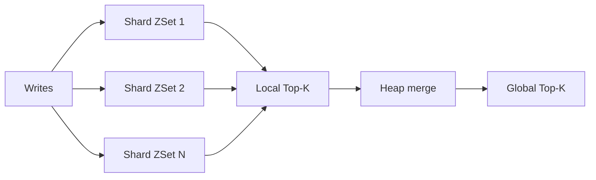

# Q098 · 设计一个高并发排行榜系统。

> **难度：** 系统设计  
> **所属章节：** 10 · Redis 8.x 与系统设计压轴题  
> **PDF 对应页：** 111  
> **目标：** 先在 60 秒内给结论，再用机制、边界和生产验证把答案展开。

## 1. 30–60 秒面试标准回答

中小规模可直接 ZSet；超大规模不能用一个全球 ZSet，应按赛区/地区/时间窗口/hash shard 维护局部榜，再从每个 shard 取局部 Top-K 在应用/聚合层 merge，历史榜按赛季或日期分段。

## 2. PDF 原理拆解

实时个人排名与全球 Top-N 可能需要不同读路径。 分片后不必取全量成员，局部候选就足以合并 Top-K； 同分规则也要稳定定义。

## 3. PDF 高频追问与答题抓手

- 追问 1 你会用哪些指标或实验验证这个方案，而不是凭经验判断？

- 追问 2 当 p99、内存或可用性目标冲突时，你会如何做权衡？

答题抓手：系统设计的真正考点是“从单 ZSet 扩展到分布式 Top-K”。

## 4. PDF 易错点 / Gotchas

不要只会 `ZREVRANGE 0 99`；不要为了多 key 方便又把所有分片 hash tag 到同一 slot。

## 5. PDF 工程落地

系统设计的真正考点是“从单 ZSet 扩展到分布式 Top-K”。

> **PDF 一句话拿分：** 中小规模可直接 ZSet；超大规模不能用一个全球 ZSet，应按赛区/地区/时间窗口/hash shard 维护局部榜，再从每个 shard 取局部 Top-K 在应用/聚合层 merge，历史榜按赛季或日期分段。  
> **GitHub 增强版一句话：** 排行榜从单 ZSet 扩到全局大规模时要解决分片 Top-K 合并、同分稳定排序、历史窗口和 Hot Key。


## 6. 深度扩展：从“会答”到“能设计”

排行榜从单 ZSet 扩到全局大规模时要解决分片 Top-K 合并、同分稳定排序、历史窗口和 Hot Key。局部 Top-K 的候选合并通常比全量汇总便宜得多。

### 6.1 成本 / 复杂度模型

单 ZSet 更新 O(log N)；分片 Top-K 合并可用堆在 O(S·K log S) 量级处理 S 个 shard 的候选。

### 6.2 生产判断框架

- 新版能力要说明版本基线与回退方案。
- 系统设计必须把容量、可用性、一致性和成本写成可验证指标。

### 6.3 面试时应主动补出的边界

- 先说明当前结论成立的前提：数据规模、读写比、是否 Cluster、是否允许数据丢失/陈旧。
- 如果涉及集合或批处理，必须说明 Big Key、单次返回体积和核心执行路径阻塞风险。
- 如果涉及 HA/一致性，必须明确网络分区、进程崩溃和 failover 后的行为，而不是只描述正常路径。
- 如果涉及性能，优先给出可观测指标和验证实验，不用“Redis 很快”替代测量。

### 6.4 可观测与验证指标

- `per-shard peak QPS`
- `headroom after failover`
- `RPO/RTO drill result`
- `cost per million ops / memory efficiency`

### 6.5 故障注入 / 实验设计

做容量和故障演练而非只做功能测试：单 shard 过载、replica 提升、缓存雪崩、网络分区、恢复和回滚。

### 6.6 面试白板图



## 7. 进一步追问树

- 跨 shard Top-K 需要从每个 shard 取多少候选？
- 如何处理 score 相同但要按更新时间/用户 ID 稳定排序？
- 当 p99、成本和可用性冲突时优先级如何排序？
- 如何设计灰度和回滚来上线新版 Redis 能力？


## 8. 可操作验证 / 命令示例

> 命令用于验证思路，生产环境执行前应评估数据规模、权限和阻塞风险。

```text
ZADD rank:2026 score user:1001
ZREVRANGE rank:2026 0 99 WITHSCORES
```


## 9. 版本与实现注意

本题以 Redis Open Source 8.10.1（2026-08）为版本基线；经典语义与版本相关实现应分开表述。

> 内部编码、命令集合和新能力会随版本变化。面试中建议先给经典语义，再说明当前版本增量。

## 10. 100 分回答评分尺

| 档位 | 能力表现 |
|---|---|
| 60 分 | 能给出定义和主结论，但没有失效边界。 |
| 80 分 | 能解释关键机制、复杂度，并回答至少两层追问。 |
| 90 分 | 能画出数据流/状态机，说明故障竞态和监控指标。 |
| 100 分 | 能从 SLO、容量、成本与版本约束重新推导方案，并指出什么时候不该使用该方案。 |

## 11. 关联题目

- [Q097 · 设计一个秒杀库存系统，你会怎么用 Redis？](q097.md)
- [Q099 · 设计一个 Redis Rate Limiter，有哪些算法？](q099.md)
- [Q008 · Sorted Set 为什么能做排行榜？](../01-data-modeling/q008.md)
- [Q018 · 什么是 Hot Key？](../02-internals-memory/q018.md)

## 12. 官方参考

- [Redis810](https://redis.io/docs/latest/develop/whats-new/8-10/)
- [Redis88](https://redis.io/docs/latest/develop/whats-new/8-8/)
- [Data Types](https://redis.io/docs/latest/develop/data-types/)
- [Cluster Spec](https://redis.io/docs/latest/operate/oss_and_stack/reference/cluster-spec/)

## 13. 专业深挖补充（v2）

> **来源说明：** 第 1–5 节保留 PDF 母版主线；本节是 GitHub 增强内容，结合 Redis 官方文档、当前版本实现语义与生产工程实践扩展。

### 13.1 核心机制再推导

超大排行榜要从“一个 ZSet”演化到分层 Top-K：按自然维度/哈希分片，分片维护局部有序集合，查询全局榜只合并每片足够大的候选。

不要停留在“记住结论”。面试时建议把本题改写成一条因果链：

```text
业务目标 / SLO
  ↓
Redis 提供的原语或内部机制
  ↓
复杂度、内存、网络与一致性成本
  ↓
故障/扩容时的边界
  ↓
可观测指标与验证实验
```

### 13.2 复杂度、容量与性能模型

全局 Top-K 可近似为 `merge(shard_top_k)`；每片候选 K 要覆盖跨片竞争边界。

计算复杂度只说明算法增长趋势，生产还必须补充四个量：

1. **N 到底是什么**：key 数、member 数、字段数、请求数还是字节数；
2. **一次返回多少字节**：很多“查找 O(1)”最终被大 reply 的网络/序列化成本主导；
3. **最坏 key/slot/shard 多大**：平均值无法解释热点和尾延迟；
4. **背景任务是否叠加**：fork、rewrite、expire、eviction、reshard 都可能与前台 workload 竞争资源。

### 13.3 生产案例推演

100 个分片各取 Top-200，应用合并后得到全局 Top-100；个人排名若必须全局精确，则成本模型与存储设计会更复杂，需要单独索引/离线计算。

面试中不要只说“可以这样做”，还应给出验收口径：

- 功能正确：正常路径和重试路径结果一致；
- 性能正确：用真实 value/member 分布测 p50/p99/p999；
- 故障正确：节点重启、超时、网络分区或消费者崩溃后状态可解释；
- 运维正确：有容量阈值、报警、回滚和恢复演练。

### 13.4 失败模式 / 什么时候不该这么做

局部 Top-K 合并适合顶部排名，不自动解决任意用户精确全局 rank；不要过度承诺。

进一步判断时，可以问自己：

- 这个方案是不是把问题从 Redis 转移到了客户端，却没有减少总体复杂度？
- 如果 key、QPS、成员数扩大 10～100 倍，是否出现不可分割的单点成本？
- 如果 primary 在最坏时刻故障，已经返回给用户的结果是否仍然成立？
- 如果 Redis 整层不可用，业务是 fail-open、fail-closed 还是降级到其他数据源？

### 13.5 源码阅读路线

建议从 **命令语义 → 数据结构 → 生命周期/故障路径** 三层阅读，而不是从 `server.c` 顺序翻完整仓库。

- 推荐入口：`src/t_zset.c` + 分片聚合逻辑
- 第一步：在该 Redis 版本的 command table 中定位命令 handler；
- 第二步：跟到对象编码/数据结构操作，记录关键 Big-O 和可能的全量遍历；
- 第三步：继续追踪 replication、AOF/RDB、lazyfree、Cluster 等副作用；
- 第四步：对照官方命令页的 `time complexity`、版本变更与 ACL category。

> 源码路径属于阅读导航，不是稳定 API；升级 Redis 后应以目标 tag/commit 为准。

### 13.6 高频追问：标准应答

**追问 A：新版能力上线时最容易遗漏什么？**  
不要只会 `ZREVRANGE 0 99`；不要为了多 key 方便又把所有分片 hash tag 到同一 slot。 应明确版本基线、客户端兼容、资源隔离、灰度指标和回滚路径。

**追问 B：如何证明这个方案值得用？**  
系统设计的真正考点是“从单 ZSet 扩展到分布式 Top-K”。 用真实数据集测吞吐、p99、内存、准确性/召回和故障恢复，而不是只做功能 demo。

### 13.7 面试官继续深挖时的回答结构

可以按下面顺序组织 2～5 分钟回答：

1. **定义**：一句话说明它解决什么问题；
2. **机制**：画出数据流/状态机，说明 Redis 内部怎样实现；
3. **复杂度**：给 Big-O，同时指出 N 与 byte size；
4. **边界**：Big Key、Hot Key、Cluster、复制、故障时会怎样；
5. **方案**：为什么选它，而不是最相近的替代方案；
6. **验证**：给出线上指标、命令或故障注入；
7. **版本**：若是 Redis 8.x 新能力，明确最低版本和回滚兼容。

### 13.8 本题复习检查表

- [ ] 我能在 30 秒内说出结论，不堆命令名。
- [ ] 我能解释至少一个内部数据结构/状态机。
- [ ] 我能说出 Big-O，并解释规模变量是什么。
- [ ] 我能指出至少两个会失效的边界条件。
- [ ] 我能给出一个真实生产案例或故障时序。
- [ ] 我能给出 3 个以上可观测指标/验证手段。
- [ ] 我能说明 Redis Cluster / replication 对本题是否有额外约束。
- [ ] 我知道目标版本的官方文档入口：<https://redis.io/docs/latest/develop/data-types/>。

---

← [Q097 设计一个秒杀库存系统，你会怎么用 Redis？](q097.md) | [章节索引](README.md) | [Q099 设计一个 Redis Rate Limiter，有哪些算法？](q099.md) →
