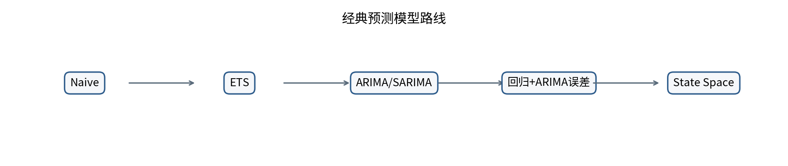
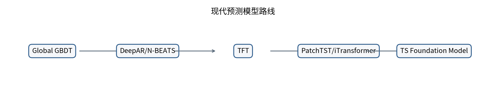
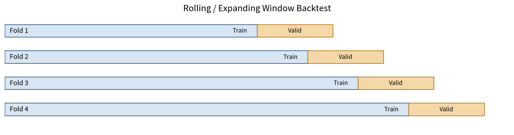
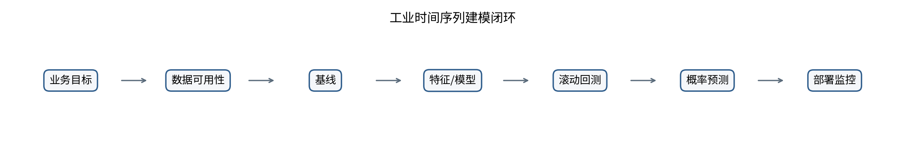

# Time Series Interview 100 · 时间序列面试 100 题
> **v2 深度增强（2026-09）**：100 道题全部新增“深度专业版 v2”章节，包含题目专属核心机制、反例/边界、业务案例、高级加分点、章节级工程 checklist、2~3 分钟口述参考和自测问题；Q97-Q100 同步补充当前 TSFM 能力边界与官方资料。

> 从统计建模到 Time-Series Foundation Models 的系统化面试仓库。  
> **100 道题 = 100 个 Markdown**，并附 PDF、代码、复习路线、速查表与 GitHub Pages 配置。


## 仓库定位

这不是“背结论”的题库。每一题按以下结构展开：

`题目 -> 20 秒回答 -> PDF 基线 -> 原理深挖 -> 追问树 -> 易错点 -> 工程检查 -> 代码/伪代码 -> 关联题 -> 延伸阅读`

仓库内容以附带 PDF 为基线；每个 Markdown 中都明确区分 **PDF 基线** 与 **GitHub 专业扩展**。

## 知识路线图

### 经典模型路线



### 现代模型路线



### 时间正确的回测



### 工业预测工作流



## 推荐学习路径

1. **第一轮：** Q001-Q035，建立统计预测骨架。
2. **第二轮：** Q036-Q078，把特征、global forecasting、rolling backtest、概率预测打通。
3. **第三轮：** Q079-Q096，训练多变量、层级、漂移和系统设计。
4. **第四轮：** Q097-Q100，掌握 TS Foundation Models，但始终与强 baseline 同协议比较。

## 目录

### 01. 时间序列基础与统计直觉 · Q001-Q010

- [Q001 什么是时间序列？它与普通 IID 数据最大的区别是什么？](docs/questions/01-foundations/q001-time-series-vs-iid.md)
- [Q002 Trend、Seasonality、Cycle 有什么区别？](docs/questions/01-foundations/q002-trend-seasonality-cycle.md)
- [Q003 White Noise 和 Random Walk 有什么区别？](docs/questions/01-foundations/q003-white-noise-vs-random-walk.md)
- [Q004 什么是 Autocorrelation？](docs/questions/01-foundations/q004-autocorrelation.md)
- [Q005 ACF 和 PACF 有什么区别？](docs/questions/01-foundations/q005-acf-vs-pacf.md)
- [Q006 什么是 Lag Operator / Backshift Operator？](docs/questions/01-foundations/q006-lag-operator.md)
- [Q007 什么叫平稳？](docs/questions/01-foundations/q007-stationarity.md)
- [Q008 Strict Stationarity 和 Weak Stationarity 有什么区别？](docs/questions/01-foundations/q008-strict-vs-weak-stationarity.md)
- [Q009 为什么采样频率非常重要？](docs/questions/01-foundations/q009-sampling-frequency.md)
- [Q010 不规则时间序列怎么处理？](docs/questions/01-foundations/q010-irregular-time-series.md)
### 02. 平稳性、差分、分解与预处理 · Q011-Q020

- [Q011 什么是 Unit Root？](docs/questions/02-stationarity/q011-unit-root.md)
- [Q012 ADF Test 在检验什么？](docs/questions/02-stationarity/q012-adf-test.md)
- [Q013 ADF 和 KPSS 为什么经常一起使用？](docs/questions/02-stationarity/q013-adf-vs-kpss.md)
- [Q014 为什么做 Differencing？](docs/questions/02-stationarity/q014-differencing.md)
- [Q015 什么是 Over-differencing？](docs/questions/02-stationarity/q015-over-differencing.md)
- [Q016 Log / Box-Cox Transformation 为什么有用？](docs/questions/02-stationarity/q016-log-boxcox-transform.md)
- [Q017 Additive Seasonality 和 Multiplicative Seasonality 怎么判断？](docs/questions/02-stationarity/q017-additive-vs-multiplicative-seasonality.md)
- [Q018 STL 是什么？](docs/questions/02-stationarity/q018-stl-decomposition.md)
- [Q019 Structural Break 会对模型造成什么影响？](docs/questions/02-stationarity/q019-structural-break.md)
- [Q020 处理缺失值为什么会产生时间泄漏？](docs/questions/02-stationarity/q020-missing-value-leakage.md)
### 03. ARIMA、ETS 与状态空间模型 · Q021-Q035

- [Q021 推导 AR(1) 的均值、方差和 ACF。](docs/questions/03-classical-models/q021-ar1-derivation.md)
- [Q022 AR(p) 的平稳条件是什么？](docs/questions/03-classical-models/q022-arp-stationarity.md)
- [Q023 MA(q) 为什么需要 invertibility？](docs/questions/03-classical-models/q023-maq-invertibility.md)
- [Q024 AR 和 MA 最大的直觉差异是什么？](docs/questions/03-classical-models/q024-ar-vs-ma.md)
- [Q025 解释 ARIMA(p,d,q)。](docs/questions/03-classical-models/q025-arima-pdq.md)
- [Q026 如何选择 p,d,q？](docs/questions/03-classical-models/q026-select-pdq.md)
- [Q027 SARIMA 是什么？](docs/questions/03-classical-models/q027-sarima.md)
- [Q028 ARIMAX / SARIMAX 中 X 是什么？](docs/questions/03-classical-models/q028-arimax-sarimax.md)
- [Q029 如何判断 ARIMA 拟合完成？](docs/questions/03-classical-models/q029-arima-residual-diagnostics.md)
- [Q030 AIC、BIC 和 Forecast Accuracy 有什么区别？](docs/questions/03-classical-models/q030-aic-bic-vs-forecast-accuracy.md)
- [Q031 ETS 是什么？](docs/questions/03-classical-models/q031-ets.md)
- [Q032 Simple Exponential Smoothing 的递推公式是什么？](docs/questions/03-classical-models/q032-simple-exponential-smoothing.md)
- [Q033 Holt 方法解决了什么问题？](docs/questions/03-classical-models/q033-holt-trend.md)
- [Q034 Holt-Winters 是什么？](docs/questions/03-classical-models/q034-holt-winters.md)
- [Q035 ARIMA 和 State Space Model 什么关系？](docs/questions/03-classical-models/q035-state-space-kalman.md)
### 04. 机器学习与大规模 Global Forecasting · Q036-Q050

- [Q036 如何把时间序列转换成监督学习问题？](docs/questions/04-machine-learning/q036-time-series-to-supervised-learning.md)
- [Q037 Lag Features 怎么选择？](docs/questions/04-machine-learning/q037-lag-feature-selection.md)
- [Q038 Rolling Features 最大的 leakage trap 是什么？](docs/questions/04-machine-learning/q038-rolling-feature-leakage.md)
- [Q039 Calendar Features 有哪些？](docs/questions/04-machine-learning/q039-calendar-features.md)
- [Q040 如何编码周期性时间特征？](docs/questions/04-machine-learning/q040-cyclical-feature-encoding.md)
- [Q041 什么是 Known Future Covariate？](docs/questions/04-machine-learning/q041-known-future-covariates.md)
- [Q042 Recursive、Direct、MIMO 多步预测有什么区别？](docs/questions/04-machine-learning/q042-recursive-direct-mimo.md)
- [Q043 Random Forest 和 ARIMA 做趋势外推时有什么区别？](docs/questions/04-machine-learning/q043-random-forest-vs-arima-extrapolation.md)
- [Q044 LightGBM 做时间序列为什么如此常见？](docs/questions/04-machine-learning/q044-lightgbm-for-time-series.md)
- [Q045 Local Model 和 Global Model 有什么区别？](docs/questions/04-machine-learning/q045-local-vs-global-model.md)
- [Q046 Global Model 怎么告诉模型“这是哪个商品”？](docs/questions/04-machine-learning/q046-series-identity-embedding.md)
- [Q047 Cold Start 怎么解决？](docs/questions/04-machine-learning/q047-cold-start.md)
- [Q048 Intermittent Demand 怎么预测？](docs/questions/04-machine-learning/q048-intermittent-demand.md)
- [Q049 Promotion / Cannibalization 怎么建模？](docs/questions/04-machine-learning/q049-promotion-cannibalization.md)
- [Q050 为什么 Ensemble 经常有效？](docs/questions/04-machine-learning/q050-forecast-ensembles.md)
### 05. 深度学习预测模型 · Q051-Q065

- [Q051 RNN 为什么适合时序？](docs/questions/05-deep-learning/q051-rnn-for-time-series.md)
- [Q052 LSTM 比 RNN 改进了什么？](docs/questions/05-deep-learning/q052-lstm-improvements.md)
- [Q053 DeepAR 的核心思想是什么？](docs/questions/05-deep-learning/q053-deepar.md)
- [Q054 N-BEATS 为什么特殊？](docs/questions/05-deep-learning/q054-nbeats.md)
- [Q055 N-HiTS 相比 N-BEATS 改了什么？](docs/questions/05-deep-learning/q055-nhits.md)
- [Q056 Temporal Fusion Transformer 为什么适合工业 forecasting？](docs/questions/05-deep-learning/q056-temporal-fusion-transformer.md)
- [Q057 Transformer 做时间序列一定比简单模型好吗？](docs/questions/05-deep-learning/q057-transformer-vs-simple-models.md)
- [Q058 DLinear 的思想是什么？](docs/questions/05-deep-learning/q058-dlinear.md)
- [Q059 PatchTST 为什么 Patch？](docs/questions/05-deep-learning/q059-patchtst.md)
- [Q060 iTransformer 的 “Inverted” 是什么？](docs/questions/05-deep-learning/q060-itransformer.md)
- [Q061 Autoformer 解决什么问题？](docs/questions/05-deep-learning/q061-autoformer.md)
- [Q062 FEDformer 为什么进入频域？](docs/questions/05-deep-learning/q062-fedformer.md)
- [Q063 TSMixer / TiDE 告诉我们什么？](docs/questions/05-deep-learning/q063-tsmixer-tide.md)
- [Q064 TimeMixer 的核心思想是什么？](docs/questions/05-deep-learning/q064-timemixer.md)
- [Q065 为什么时序 normalization 比普通 ML 更棘手？](docs/questions/05-deep-learning/q065-time-series-normalization.md)
### 06. 回测、指标与概率预测 · Q066-Q078

- [Q066 为什么不能 Random K-Fold？](docs/questions/06-evaluation-probabilistic/q066-why-not-random-kfold.md)
- [Q067 Expanding Window 和 Sliding Window 的区别？](docs/questions/06-evaluation-probabilistic/q067-expanding-vs-sliding-window.md)
- [Q068 为什么必须按 Forecast Horizon 评估？](docs/questions/06-evaluation-probabilistic/q068-evaluate-by-horizon.md)
- [Q069 常见 Data Leakage 有哪些？](docs/questions/06-evaluation-probabilistic/q069-time-series-data-leakage.md)
- [Q070 RMSE 和 MAE 有什么区别？](docs/questions/06-evaluation-probabilistic/q070-rmse-vs-mae.md)
- [Q071 MAPE 有什么致命问题？](docs/questions/06-evaluation-probabilistic/q071-mape-problems.md)
- [Q072 sMAPE 真的是完全 symmetric 吗？](docs/questions/06-evaluation-probabilistic/q072-smape-caveats.md)
- [Q073 为什么 MASE 很重要？](docs/questions/06-evaluation-probabilistic/q073-mase.md)
- [Q074 RMSSE 是什么？](docs/questions/06-evaluation-probabilistic/q074-rmsse.md)
- [Q075 Quantile Loss 如何实现概率预测？](docs/questions/06-evaluation-probabilistic/q075-quantile-pinball-loss.md)
- [Q076 CRPS 是什么？](docs/questions/06-evaluation-probabilistic/q076-crps.md)
- [Q077 Prediction Interval 怎么评价？](docs/questions/06-evaluation-probabilistic/q077-prediction-interval-evaluation.md)
- [Q078 如果缺货成本比库存成本高 5 倍，该用什么 loss？](docs/questions/06-evaluation-probabilistic/q078-asymmetric-business-loss.md)
### 07. 多变量、协整、层级与因果 · Q079-Q088

- [Q079 VAR 是什么？](docs/questions/07-multivariate-hierarchical-causal/q079-var.md)
- [Q080 什么是 Granger Causality？](docs/questions/07-multivariate-hierarchical-causal/q080-granger-causality.md)
- [Q081 什么是 Cointegration？](docs/questions/07-multivariate-hierarchical-causal/q081-cointegration.md)
- [Q082 什么是 Spurious Regression？](docs/questions/07-multivariate-hierarchical-causal/q082-spurious-regression.md)
- [Q083 Error Correction Model 为什么重要？](docs/questions/07-multivariate-hierarchical-causal/q083-error-correction-model.md)
- [Q084 Cross-correlation 有什么坑？](docs/questions/07-multivariate-hierarchical-causal/q084-cross-correlation-caveats.md)
- [Q085 什么是 Hierarchical Forecasting？](docs/questions/07-multivariate-hierarchical-causal/q085-hierarchical-forecasting.md)
- [Q086 Bottom-up、Top-down 和 MinT 有什么区别？](docs/questions/07-multivariate-hierarchical-causal/q086-bottom-up-top-down-mint.md)
- [Q087 一个序列同时有日、周、年周期怎么办？](docs/questions/07-multivariate-hierarchical-causal/q087-multiple-seasonality.md)
- [Q088 Forecasting 与 Causal Inference 有什么区别？](docs/questions/07-multivariate-hierarchical-causal/q088-forecasting-vs-causal-inference.md)
### 08. 异常检测、变化点与漂移 · Q089-Q093

- [Q089 Point、Contextual 和 Collective Anomaly 有何区别？](docs/questions/08-anomaly-drift/q089-anomaly-types.md)
- [Q090 如何利用 STL 做异常检测？](docs/questions/08-anomaly-drift/q090-stl-anomaly-detection.md)
- [Q091 Change Point Detection 和 Anomaly Detection 有何不同？](docs/questions/08-anomaly-drift/q091-change-point-vs-anomaly.md)
- [Q092 Concept Drift 怎么处理？](docs/questions/08-anomaly-drift/q092-concept-drift.md)
- [Q093 生产环境为什么只监控 RMSE 不够？](docs/questions/08-anomaly-drift/q093-production-monitoring-beyond-rmse.md)
### 09. 工业系统设计题 · Q094-Q096

- [Q094 设计一个完整的销量预测系统。](docs/questions/09-system-design/q094-sales-forecasting-system-design.md)
- [Q095 你有 100 万个 SKU-store series，怎么建模？](docs/questions/09-system-design/q095-million-sku-store-series.md)
- [Q096 如何 Debug 一个“离线 RMSE 极好，上线完全失效”的 forecasting pipeline？](docs/questions/09-system-design/q096-debug-offline-good-online-bad.md)
### 10. Time-Series Foundation Models · Q097-Q100

- [Q097 什么叫 Time-Series Foundation Model？](docs/questions/10-foundation-models/q097-time-series-foundation-model.md)
- [Q098 TimesFM、Chronos、Moirai 的思想有什么不同？](docs/questions/10-foundation-models/q098-timesfm-chronos-moirai.md)
- [Q099 Foundation Model 会不会淘汰 ARIMA / LightGBM？](docs/questions/10-foundation-models/q099-will-foundation-models-replace-classical.md)
- [Q100 2026 前沿：TimesFM-3 相比 TimesFM-2.5 真正解决了什么？](docs/questions/10-foundation-models/q100-timesfm3-vs-timesfm25.md)

## 仓库结构

```text
time-series-interview-100/
├── README.md
├── INDEX.md
├── STUDY_PLAN.md
├── TAGS.md
├── CHEATSHEET.md
├── REFERENCES.md
├── pdf/
│   └── 时间序列面试100题_专业详细版_2026.pdf
├── docs/
│   ├── questions/
│   │   ├── 01-foundations/
│   │   ├── ...
│   │   └── 10-foundation-models/
│   └── assets/diagrams/
├── src/ts_interview/
│   ├── validation.py
│   ├── features.py
│   ├── metrics.py
│   └── baselines.py
├── examples/
├── tests/
├── mkdocs.yml
└── .github/workflows/
```

## 快速运行代码示例

```bash
python -m venv .venv
source .venv/bin/activate  # Windows: .venv\Scripts\activate
pip install -r requirements.txt
PYTHONPATH=src pytest -q
PYTHONPATH=src python examples/leakage_safe_backtest.py
python scripts/validate_repo.py
python scripts/check_links.py
```

## 内容原则

- **时间正确性优先于模型复杂度。**
- 所有 preprocessing 都应在每个 backtest fold 内拟合。
- 所有 feature 都应回答“预测时是否真的可见”。
- 概率预测同时看 calibration 与 sharpness。
- 业务预测优先优化 decision cost，而不是盲目追求单一 RMSE。
- Foundation Model 是新的强 baseline，不是“自动淘汰经典模型”的理由。

## PDF

- [`pdf/时间序列面试100题_专业详细版_2026.pdf`](pdf/时间序列面试100题_专业详细版_2026.pdf)

## License

MIT。若计划公开发布，可按你的组织要求替换许可证与版权信息。
